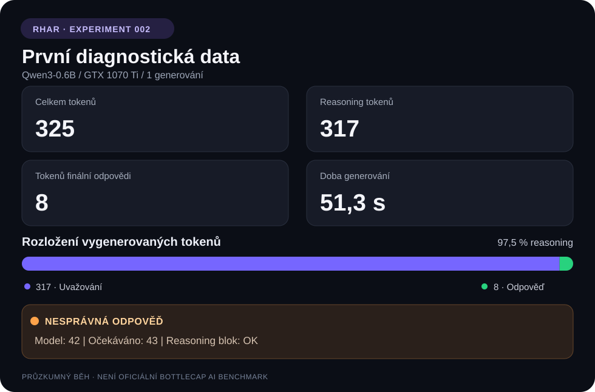

# 🔬 DEV-NOTES — Vývojový deník

[🇨🇿 Česky](DEV-NOTES.md) · [🇬🇧 English](../docs/DEV-NOTES.en.md)

## Pravidla spolupráce

- **O důležitých technických rozhodnutích, experimentech a nových nápadech rozhoduji já.** Než uděláme zásadní změnu, nejprve spolu probereme možnosti, rizika a další postup.
- Bez mého výslovného rozhodnutí neměnit směr výzkumu, model, trénovací strategii, benchmarkové podmínky, strukturu projektu ani neprovádět zásadní změny v repozitáři.
- Běžné, výslovně zadané úpravy dokumentace a technické opravy v odsouhlaseném rozsahu lze provádět, s jasným zápisem do deníku.
- Rozlišovat **provedeno / ověřeno / navrženo / čeká na schválení / chyba**. Nikdy nepředstírat úspěch testů nebo naměřené výsledky.
- Zápisy uvádějí datum, změny, důvod, ověření a další krok. Zásadní rozhodnutí mají explicitní stav schválení.
- **Bez zelených testů ani krok** při změnách kódu; pro dokumentační změny ověřit strukturu a odkazy.

## Deník

### 🌙 2026-10-10 — Konec dne / Co jsme se dnes naučili

**Stav dne: práce pro dnešek končí.** Dnešní cíl nebyl trénovat Qwen, ale postavit bezpečnou, reprodukovatelnou přípravu výzkumu **RHAR — Rabbit Hollow Adaptive Reasoning**. Začali jsme CPU plánovačem a skončili plně zelenou sadou **103/103 testů** (`Ran 103 tests in 0.917s`, `OK`) a ověřeným generovacím `--dry-run`. To je skutečný výsledek dne, **ne** naměřená úspora tokenů.

**Co jsme dnes reálně zvládli:** z připnuté revize `openai/gsm8k` jsme na Kali ověřili SHA-256 trénovacího Parquet souboru, načetli **7 473** záznamů a deterministicky vybrali **12 kandidátních matematických úloh**. Připravili jsme přesný plán **12 × 3 = 36** budoucích generací modelu `Qwen/Qwen3-0.6B`, seedy `9001, 9002, 9003`, zapnutý thinking, temperature `0.6`, top_p `0.95`, top_k `20` a limit `512` nových tokenů. Před skutečným během generátor ověřuje vybraných 12 ID, hashe lokálních vstupů a dokončený audit překryvu. Naše testovací brány dnes postupně narostly z **45 → 61 → 79 → 103** a každá kompletní sada byla po dokončení příslušného kroku zelená.

**Co jsme se naučili z chyb:** 
- **Reprodukovatelnost není detail.** Bez připnuté revize datasetu/modelu, SHA-256, pevných seedů a přesného promptu by výsledky nešly férově porovnat. Gold odpovědi patří do kontroly správnosti, **nikoli do promptu**.
- **Závislosti mohou zablokovat i zdánlivě jednoduchý CPU krok.** `pyarrow` nejprve chybělo a pak jeho novější verze vyžadovala NumPy 2.x, zatímco Kali mělo NumPy `1.26.4`. Naučili jsme se řešit konflikt cíleně: kompatibilní `pyarrow==16.1.0`, ne nekontrolovaný upgrade celé AI sestavy.
- **Nulový počet nalezených shod neznamená dokonalý důkaz čistoty.** Samostatně jsme porovnali našich 12 GSM8K otázek s **2 759** texty ze šesti připnutých zdrojových souborů SVAMP, MBPP+, BFCL a IFEval. Audit našel **0 přesných či výrazně podobných textových shod**, ale **nevylučuje sémantické parafráze**, a proto výsledné kandidáty ponecháváme jen jako `review_only`.
- **U reasoning modelu rozhodují skutečně vygenerované tokeny.** Rozlišujeme reasoning a final, správně pracujeme s předvyplněným `<think>`, hranicemi `</think>` a ukončovacími tokeny. `reasoning_tokens + final_tokens` musí odpovídat celkovému počtu vygenerovaných tokenů. Neznámý rozpad není nula; useknutý nebo nesprávný výstup nesmíme vydávat za úspěšný.
- **Zelené CPU testy ověřují přípravu, ne kvalitu modelu.** `--dry-run` ověřil všechny tři lokální vstupy i plán, ale **nenačetl model, nepoužil GPU, negeneroval odpovědi a nic netrénoval**. Zatím nemáme srovnání efektivity ani důkaz zlepšení RHAR. Nezaměňujeme krátkou odpověď za správnou.

**Technické poučení pro další vývoj:** malý, auditovatelný experiment s jasnými stop podmínkami je lepší než drahý běh bez kontroly. Důležitá jsou oddělená oprávnění pro **přípravu → CPU validaci → GPU inferenci → případné trénování**. Vytvořené skripty umí budoucí GPU běh jen po dvou explicitních přepínačích; bez mého samostatného schválení se nic nespouští.

**Zítra / příště (plán, nikoli provedená práce):** nejprve pouze CPU kontrola dostupnosti lokální cache Qwenu, kompatibility CUDA/FP16, volné VRAM a návrh časového limitu, ukládání průběžných dat a podmínek zastavení. Teprve potom se samostatně rozhodnu, zda dovolit krátký canary test nebo celých **36 generací**. **GPU inference, LoRA/trénování a oficiální benchmark dnes neproběhly ani nejsou pro další krok automaticky schválené.**

**Dnešní bilance:** **103/103 CPU testů OK · 12 ověřených kandidátů · 2 759 porovnaných evaluačních zadání · 0 heuristických shod · 36 pouze naplánovaných generací · 0 GPU běhů · 0 trénování.** 🐇🛡️

### 2026-10-10 — ✅ Safe Start generátor: 103/103 CPU testů zelených v Kali

**Skutečně ověřeno v mém Kali/WSL2:** společná sada `tests.test_offline_selector`, `tests.test_reasoning_probe`, `tests.test_safe_start_plan`, `tests.test_safe_start_data`, `tests.test_safe_start_overlap` a `tests.test_safe_start_generate` skončila `Ran 103 tests in 0.917s`, `OK`. Tím je potvrzena nová regresní brána, nikoli skutečný GPU experiment.

**Skutečný příkaz:** `python -m diagnostics.safe_start_generate --dry-run` potvrdil `status=plan_only`, model `Qwen/Qwen3-0.6B` revize `c1899de289a04d12100db370d81485cdf75e47ca`, `thinking_enabled=true`, 12 přesně původních GSM8K train kandidátů × 3 seedy (`9001,9002,9003`) = **36 plánovaných generací**, sampling temperature 0.6 / top_p 0.95 / top_k 20 a `max_new_tokens=512`.

**SHA-256 lokálních vstupů z ověřeného dry-runu:** `questions=ebb3595c677ec6a660da3ff8731448182674967beab4d5e7f5256347541d32bc`; `selection_report=0760c4825de4e18bbbfcb6429dd543dcfa7fcc9e18dae83a118bccdf2b3cb89a`; `overlap_audit=7b9443abf9e2960084bfaf6472ddf049ff057d4f4e1c889a4c01902a2ccc7ca4`. Tyto hashe vážou dry-run na konkrétní lokální soubory a obsah auditu, ale nejsou důkazem absence všech sémantických parafrází.

**Výslovné hranice:** `gpu_used=false`, `model_loaded=false`, `model_downloaded=false`, `training_performed=false`, `training_approved=false`, `official_benchmark=false`, `model_generations_performed=0`. **Nebyly vyrobeny nové modelové odpovědi ani změřena tokenová úspora.**

**Další rozhodnutí čeká na mé schválení:** před skutečnými 36 CUDA generacemi samostatně probrat časový/GPU rozpočet, předběžné ověření lokální cache a stop podmínky, případně krátký canary běh jen po výslovném povolení. Nic nyní nespouštět; záznamy zůstávají `review_only`.

### 2026-10-10 — 🐇 RHAR Safe Start: GPU skript připraven, spuštění NEschváleno

**Moje schválení:** po `Ran 79 tests in 0.832s` / `OK` a kontrolním auditu 12 GSM8K train kandidátů proti 2 759 oficiálním zadáním (0 nalezených heuristických textových shod, parafráze nevyloučené) jsem odsouhlasil **výhradně implementaci budoucího GPU skriptu a jednotkových CPU testů**. **Žádný nový GPU běh, inference, download modelu ani trénování nebyly povoleny nebo provedeny.**

**Přidané soubory:** `diagnostics/safe_start_generate.py` a `tests/test_safe_start_generate.py` (**24 nových testovacích metod**). Generátor předem ověřuje 12 přesných otázek, SHA-256 obou review manifestů i všech šest záznamů auditu; bez aktuálního úspěšného screeningu odmítá pokračovat. Z konfigurace `safe_start_plan.py` přebírá model Qwen3-0.6B, připnutou revizi, tři seedy 9001/9002/9003, thinking zapnutý, sampling 0.6/0.95/20 a 512-tokenový limit. Prompty neobsahují gold odpověď ani instrukci ke zkrácení uvažování.

**Ochrany:** `--dry-run` zůstává CPU-only, bez modelu, sítí či GPU. Budoucí generování vyžaduje oba explicitní přepínače `--execute` a `--confirm-gpu-36` **a můj samostatný pozdější souhlas**. V GPU režimu je povolen jen místní již uložený model (`local_files_only=True`), CUDA float16, žádný automatický download. Délky reasoning + final musí dát skutečně generované tokeny; nesprávné a truncated odpovědi neuznávám za správné. Nekompletní výsledek se nevydává za dokončených 36 vzorků; každé spuštění vytváří novou ignorovanou složku a nesmí přepsat předchozí data. Záznamy lze předat `diagnostics/offline_selector.py`, ne přímo trénování.

**Ověření:** v izolovaném lokálním prostředí prošlo **23 CPU testů prototypu**, s lehkými kopiemi závislostí; **novou přesnou sadu 24 testů na GitHub větvi ani všech 103 společně jsem ještě nepotvrdil na Kali**. Počet 103 je plánovaných 79 + 24. Bez zeleného skutečného Kali výstupu žádný další krok.

**Dokumentace:** [SAFE-START-GENERATION.md](SAFE-START-GENERATION.md) / [English](../docs/SAFE-START-GENERATION.en.md). Další jediný doporučený příkaz: všech 103 CPU testů a `python -m diagnostics.safe_start_generate --dry-run`; nikoli GPU.

### 2026-10-10 — ✅ RHAR Safe Start: 79/79 CPU testů zelených na Kali

**Skutečný výstup terminálu:** `Ran 79 tests in 0.832s` a `OK`. Potvrzuji společný běh všech 79 CPU unit testů: offline selektor, reasoning diagnostika, plánovač Safe Start, výběr GSM8K dat a nový audit překryvu. Toto je první doložený **celý společný** běh aktualizované sady na mém Kali/WSL2.

**Předchozí doložený audit:** `python -m diagnostics.safe_start_overlap --download` úspěšně porovnal 12 připnutých GSM8K kandidátů se **2 759 zadáními** ze šesti souborů SVAMP, MBPP+, BFCL a IFEval a nahlásil **0 textových shod** podle implementované heuristiky. `semantic_paraphrases_ruled_out=false` a `overlap_audit_exhaustive=false`, takže ani tento výsledek neprokazuje vyloučení všech sémantických parafrází.

**Uzavřená brána:** CPU příprava, 12 kandidátů, 36 budoucích plánovaných pokusů, kontrola integrity souborů a regresní testy jsou zelené. Neproběhlo žádné nové generování Qwen3-0.6B, použití GPU, trénování, ani oficiální benchmark. `review_only` a `training_approved=false` zatím zůstávají beze změny.

**Další rozhodnutí (dosud neschváleno):** samostatně projít rozpočet, stop podmínky a implementaci první GPU generovací fáze **12 otázek × 3 seedy = 36 generací**, bez LoRA a bez automatického použití výstupů pro trénování. **Bez mého souhlasu GPU nespouštět.**

### 2026-10-10 — ✅ Skutečný CPU audit překryvu: 0 shod v 2 759 evaluačních otázkách

**Skutečně provedeno na Kali / WSL2:** `python -m diagnostics.safe_start_overlap --download` doběhl úspěšně a vypsal `audit_result=no_matches_in_screened_sources`. Porovnal **12 původních GSM8K train kandidátů** (připnutá revize `740312add88f781978c0658806c59bc2815b9866`) s texty **2 759 zadání** ze všech šesti deklarovaných souborů a čtyř rodin benchmarků.

**Rozpad skutečného auditu:** SVAMP 1 000, MBPP+ 378, BFCL simple_python 400, BFCL multiple 200, BFCL irrelevance 240, IFEval 541. **Nalezeno 0 potenciálních přesných nebo heuristicky podobných shod**, `potential_matches=[]`. Zdrojové soubory SVAMP a MBPP+ prošly předem známou kontrolou SHA-256. Skutečné SHA-256 připnutých BFCL souborů: `82dd63ba502eb2520c6b5d1d9a5c4b590e03ff261565175561f6228a367d1991`, `aef168155ebd74b7ac2401198b201343bc7d16d7a3d7e0d4e6d8ee82c6969b2a`, `2b6ed4c2e992cdcf5f1678a701851f944bef7550ee026ed1ddb89efed5be01a6`; IFEval: `67ffeee0fcb87c317c5b08a2de85557b4a7e96ada6178aa645b4954fe4b53d49`. U BFCL/IFEval jsou tyto hashe pouze **zaznamenané**, bez nezávislé předem fixované kontroly (`known_sha256_pin_checked=false`).

**Interpretace:** výsledek platí **jen pro šest deklarovaných souborů a dané pravidlo podobnosti**. `semantic_paraphrases_ruled_out=false` a `overlap_audit_exhaustive=false`: neprokazuje nulovou kontaminaci ani nevylučuje sémantické parafráze. `status=review_only`, `training_approved=false`; dataset ani původní výběr nebyly změněny. **Žádná inference, GPU, trénování ani oficiální evaluace** (`gpu_used=false`, `model_generations_performed=0`, `training_performed=false`, `official_benchmark_run=false`).

**Testovací brána:** předchozích 61/61 testů bylo potvrzeno, ale **samostatný kombinovaný běh 79/79 v uživatelově novém terminálovém výstupu zatím není doložen**. O schválení generování ani trénování nyní nerozhoduji. Nejprve získám zelený výstup všech 79 CPU testů, pak se zvlášť rozhodnu o další experimentální fázi.

### 2026-10-10 — 🛡️ Schválena CPU kontrola překryvu 12 GSM8K kandidátů vůči oficiálním otázkám

**Rozhodnutí:** po úspěšném **61/61 CPU testů v Kali (`Ran 61 tests in 0.600s`, `OK`)** a zjištění, že nemám lokální `questions/questions.jsonl`, jsem výslovně schválil **pouze přípravu a stažení připnutých oficiálních evaluačních textů kvůli decontamination screeningu**. Nepovolil jsem inference, GPU, trénování ani oficiální evaluační běh.

**Implementace:** nový izolovaný `diagnostics/safe_start_overlap.py` a `tests/test_safe_start_overlap.py`. Kontroluji přesně šest vstupních souborů ze čtyř rodin (SVAMP, MBPP+, 3 BFCL v4 kategorie, IFEval) na revizích z **nezměněného** `utils/eval/benchmarks.py`. SVAMP a MBPP+ ověřuji také proti známému SHA-256. BFCL/IFEval jsou připnuté Git commitem; zaznamenávám skutečný hash souboru. Ve všech případech extrahuji pouze texty zadání, nikoli gold answers. Přímý downloader oficiální evaluace ani jeho verifiery nespouštím.

**Ochrany:** před síťovým přístupem ověřím SHA-256 a ID našich **stávajících 12 otázek** proti původnímu `selection-report.json`; žádný automatický nový výběr. Chybějící zdroj, selhání hashe či neplatné schéma zruší audit bez pozitivního reportu. Finální ignorovaný `data/safe-start/overlap-audit.json` obsahuje jen evidenci, počty, hashe a indexy potenciálních shod. Nikdy nedeklaruje úplnou odolnost proti parafrázím ani `training_approved=true`.

**Ověření:** nových **18/18** unit testů prošlo **v izolovaném místním CPU prostředí**, se simulovanými síťovými zdroji; verifikoval jsem přesné kopie Python souborů na GitHubu. **Společná sada 79/79 a skutečné stažení všech šesti zdrojů v Kali ještě čekají**. V tomto kroku nebyl spuštěn model ani GPU.

**Dokumentace:** [SAFE-START-OVERLAP.md](SAFE-START-OVERLAP.md) / [English](../docs/SAFE-START-OVERLAP.en.md). Další postup: po pullu nejprve všechny testy; teprve poté `python -m diagnostics.safe_start_overlap --download`, vyhodnotit výstup a před jakýmkoli dalším experimentem si vyžádat nové schválení.

### 2026-10-10 — ✅ Kompletní Safe Start CPU suite 61/61 OK; eval korpus chybí

**Skutečný výstup z mého Kali/WSL2:** po synchronizaci větve `feat/reasoning-compression` jsem spustil společně `tests.test_offline_selector`, `tests.test_reasoning_probe`, `tests.test_safe_start_plan` a `tests.test_safe_start_data`. Terminál potvrdil **`Ran 61 tests in 0.600s`** a **`OK`**. Tím je doložená celá aktuální CPU testovací sada, nikoli jen oddělené běhy 45 + 16 testů.

Kontrola `test -f questions/questions.jsonl` oznámila **`Eval otázky chybí`**. Z předchozího skutečného reportu platí `overlap_audit_status=pending_local_eval_corpus`, `local_eval_audit_performed=false` a `overlap_audit_exhaustive=false`. **Nulový počet odmítnutých překryvů bez eval korpusu není důkaz absence kontaminace.**

**Uzavřená fáze:** úspěšná CPU validace schématu, načtení ověřeného GSM8K train souboru, výběr 12 kandidátů a příprava 36 *plánovaných* pokusů. **Neprovedeno a neschváleno:** stahování oficiálních evaluačních dat, spuštění oficiálního benchmarku, GPU inference, LoRA/trénování či měření tokenové úspory.

**Další volba:** nejprve schválit pouze kontrolu překryvu proti správným připnutým evaluačním otázkám; můj existující `utils/eval/benchmarks.py` při přímém spuštění stahuje další závislosti a sestaví celý benchmark, proto se nespouští automaticky. Výběr 12 příkladů zůstává `review_only`.

### 2026-10-10 — ✅ GSM8K Safe Start: potvrzen skutečný CPU výběr 12 úloh na Kali

**Skutečný výstup terminálu:** `Ran 16 tests in 0.512s`, `OK` pro `tests.test_safe_start_data`. `python -m diagnostics.safe_start_data --download` úspěšně zpracoval **7473 záznamů** z GSM8K `main/train`, zafixovaná revize `740312add88f781978c0658806c59bc2815b9866`; report uvedl `download_status=verified_cached` a kontrolní SHA-256 `ea82612ea9582142387730c793eb67d3b12849002bc0b7fa6f8efafa7351419d`.

**Vybrané identifikátory (v pořadí):** `gsm8k-train-06982, gsm8k-train-01136, gsm8k-train-06866, gsm8k-train-02829, gsm8k-train-01500, gsm8k-train-01015, gsm8k-train-01832, gsm8k-train-03268, gsm8k-train-06657, gsm8k-train-06089, gsm8k-train-02730, gsm8k-train-01217`. Výstup `selection-report.json` obsahuje rovněž SHA-256 každé otázky, ale skutečné znění otázek a gold answers ponechávám v lokálním ignorovaném `data/safe-start/questions.jsonl`.

**Ověřený dry run:** `python -m diagnostics.safe_start_plan --dry-run --questions data/safe-start/questions.jsonl` úspěšně validoval 12 otázek a naplánoval **36 pokusů** (`9001/9002/9003`; Qwen3-0.6B, thinking=true). **V tomto kroku se neprovedla žádná inference, GPU ani trénování**; výběr stále hlásí `review_only` a `training_approved=false`.

**Neuzavřená kontrola:** `overlap_audit_status=pending_local_eval_corpus`, `local_eval_audit_performed=false`, `overlap_audit_exhaustive=false`. Nulové počty vyřazených kandidátů **neznamenají ověřenou čistotu vůči oficiálním benchmarkům**. Bez dalšího odsouhlasení nestahuji evaluační data ani nespouštím GPU.

**Opravená závislost:** nejprve selhal import PyArrow kvůli NumPy 1.26.4 a novější nekompatibilní verzi. Po doporučené instalaci kompatibilní verze už skutečný CPU výběr fungoval. Do `requirements.txt` jsem proto připnul `pyarrow==16.1.0`. Celou kombinovanou sadu **61/61 na Kali ještě nemám doloženou**; doložené jsou dřívějších 45/45 a nynějších 16/16 jako dva samostatné běhy.

### 2026-10-10 — 🐇 Schváleno CPU stažení GSM8K train a výběr 12 úloh

**Moje rozhodnutí:** po úspěšném **45/45 testů za 0,045 s** na Kali a výstupu `safe_start_plan --dry-run` (`plan_only`, 12 otázek, 36 plánovaných pokusů, `gpu_used=false`) jsem schválil další krok: **pouze CPU stažení GSM8K main/train a deterministický výběr 12 kandidátů**. Neschválil jsem GPU sampling, LoRA, trénování ani použití zvolených otázek bez další revize.

**Implementoval jsem:** `diagnostics/safe_start_data.py` a `tests/test_safe_start_data.py` (16 nových jednotkových testů). Dataset je připnut k revizi `740312add88f781978c0658806c59bc2815b9866`; stahuji jen `main/train-00000-of-00001.parquet` s očekávaným SHA-256 `ea82612ea9582142387730c793eb67d3b12849002bc0b7fa6f8efafa7351419d`. Výběr používá zafixované řazení podle SHA-256, odmítá nečíselné výsledky, duplicity a zjevné překryvy s případným lokálním evaluačním souborem. Žádné oficiální benchmarky neupravuji. Artefakty pod `data/safe-start/` jsou `review_only`, nikdy automatická trénovací sada.

**Ověření:** 16/16 nových CPU testů a předchozích 15 testů plánovače (**31/31**) prošlo v izolovaném lokálním prostředí. Síťové stahování bylo při unit testech simulováno; **reálné stažení GSM8K v mém Kali a společná sada 61/61 zatím nejsou doložené**. GitHub obsah dvou nových Python souborů jsem ověřil proti lokálně testované verzi.

**Přesný postup:** [SAFE-START-DATA.md](SAFE-START-DATA.md) / [English](../docs/SAFE-START-DATA.en.md). První příkaz v Kali je společná CPU sada testů. Teprve po její zelené kontrole smím spustit `python -m diagnostics.safe_start_data --download`, zkontrolovat `selection-report.json` a potvrdit 12 skutečných identit úloh. Pokud nemám k dispozici lokální evaluační otázky, kontrola překryvu zůstane `pending_local_eval_corpus`; **nesmím tvrdit, že byla prokázána absence kontaminace**.

### 2026-10-10 — 🐇 Schválen RHAR Safe Start, CPU plán a testy

**Moje rozhodnutí:** schválil jsem první bezpečný malý pilot **12 matematických úloh × 3 generace**. Zatím jsem však povolil **pouze implementační plán, CPU validaci a jednotkové testy**, nikoli stažení dat, GPU inferenci nebo trénování.

**Implementováno:** `diagnostics/safe_start_plan.py` a `tests/test_safe_start_plan.py`. Plánovač připraví přesně 36 *plánovaných* pokusů se seedy 9001/9002/9003, připnutým Qwen3-0.6B, zapnutým thinking, samplingem 0.6/0.95/20 a limitem 512. Pro budoucí ručně předložený zdroj zatím nabízí pouze přísnou kontrolu 12 JSONL řádků GSM8K/train/math a pinned 40hex revize. Odmítá neočekávaná pole, chybné gold answers, duplicity, evaluační zdroje a jiná rozdělení. Nedělá žádné síťové požadavky ani modelové generování.

**Ověřeno:** izolovaně **15/15 nových CPU testů — OK**; `python -m diagnostics.safe_start_plan --dry-run` vrací `status=plan_only`, `planned_generations=36`, `gpu_used=false`, `dataset_downloaded=false`, `training_performed=false`. Ověření proběhlo v lokálním prostředí se shodnými konstantami původní diagnostiky, nikoli v úplném checkoutu repozitáře.

**Z předchozí fáze:** 30/30 CPU testů selektoru a diagnostiky potvrzeno na Kali. **Aktuální součet 45 testů zatím nemám ze svého Kali doložený** — čekám na `git pull` a kombinovaný testovací příkaz.

**Dokumentace:** [SAFE-START.md](SAFE-START.md) / [English](../docs/SAFE-START.en.md) obsahuje technický kontrakt, parametry, stop podmínky, hrubé náklady a explicitní oddělení plánování od experimentu. Žádná skutečná zdrojová úloha není stažena; kontrola názvu zdroje sama nedokáže vyloučit překryv s oficiální evaluací.

**Neprovedeno:** žádné nové modelové odpovědi, GPU, LoRA, změny vah, oficiální evaluace ani měřitelné tokenové úspory. **Další krok:** ověřit společných 45 CPU testů v Kali a potom zvlášť schválit konkrétní datové otázky a jejich původ.

### 2026-10-09 — ✅ RHAR v0.1: 30/30 CPU testů potvrzeno

**Skutečně ověřeno v mém Kali / WSL2:** po opravě starého formátu diagnostických záznamů jsem spustil společnou jednotkovou sadu selektoru a reasoning diagnostiky. Terminál skončil:

- `Ran 30 tests in 0.023s`
- `OK`

**Výsledek:** **30/30 testů prošlo**, žádný test nehlásil chybu ani selhání. Jde o **20 testů v `tests.test_offline_selector` a 10 testů v `tests.test_reasoning_probe`**. Čas **0,023 s** je čas reportovaný modulem `unittest` pro tuto CPU sadu, nikoli rychlost inference ani trénování.

**Navazující skutečně ověřený offline běh:** `runs/offline/20261009T214634155051Z/` na původním souboru `runs/diagnostics/20261009T210123Z/records.jsonl` správně hlásil `incorrect_answer: 1`, `correct_final_answers: 0` a `selected_for_review: 0`. SHA-256 vstupu `bf9360243279dd0a6636111c955492018521b00e18a390f3770ae36caab25de0`. Starší neúspěšný diagnostický výsledek zůstává zachován.

**Interpretace a hranice důkazu:** první **offline / CPU část RHAR v0.1** má nyní potvrzené regresní testy i kontrolu historického vstupu. **Netrénoval jsem Qwen, nezměnil modelové váhy, nemám zatím novou GPU inferenci, oficiální benchmark ani doloženou úsporu tokenů.** Správný finální výsledek také sám nedokazuje bezchybnost celého reasoning trace.

**Další krok, zatím neproveden:** rozhodnout o přesném návrhu sběru povolených trénovacích příkladů, jeho nákladech a validačních kontrolách. Nejdřív odsouhlasím konkrétní experiment, teprve pak spustím generování nebo trénování.

### 2026-10-09 — ✅ Ověření opraveného offline selektoru v Kali

**Skutečně provedeno:** po opravě kompatibility se starými diagnostickými záznamy jsem znovu spustil `python -m diagnostics.offline_selector runs/diagnostics/20261009T210123Z/records.jsonl` ve svém Kali / WSL2. Nepouštěl jsem žádnou novou inferenci ani trénování.

**Výsledek (doslovné hodnoty souhrnu):**

| Metrika | Hodnota |
| --- | ---: |
| `records` | **1** |
| `correct_final_answers` | **0** |
| `training_eligible_candidates` | **0** |
| `selected_for_review` | **0** |
| `reasons` | `{"incorrect_answer": 1}` |
| `no_training_performed` | `true` |
| `official_benchmark` | `false` |
| `review_only` | `true` |

**Identita a reprodukovatelnost:** zdrojový soubor `runs/diagnostics/20261009T210123Z/records.jsonl`, SHA-256 `bf9360243279dd0a6636111c955492018521b00e18a390f3770ae36caab25de0`; výstupní složka `runs/offline/20261009T214634155051Z/`. Stejný SHA-256 jako při předchozím běhu znamená, že hodnotím stejné vstupní bajty.

**Interpretace:** oproti prvnímu offline běhu, který chybně skončil `invalid_question_metadata: 1`, teď selektor pro známou úlohu `arithmetic_apples` správně rozlišil nesprávnou finální odpověď **42 místo očekávaných 43**. Žádný kandidát neprošel do trénovacího výběru; staré diagnostické záznamy navíc nemají požadovaná metadata pro trénování. Oprava tedy **funguje v tomto jednom reálném případu**, ale sama nedokazuje obecnou spolehlivost selektoru.

**Stav testování:** výpis potvrzuje **úspěšný offline CLI běh**, nikoli kompletní regresní sadu. Ve zdrojovém kódu je **20 testů selektoru + 10 testů reasoning diagnostiky**; výsledný běh `python -m unittest tests.test_offline_selector tests.test_reasoning_probe -v` z mého Kali **zatím nemám doložený**. Neoznačuji 30/30 za splněné.

**Historie:** starý výstup `runs/offline/20261009T214125471552Z/` ponechávám beze změny jako záznam původní chyby. Tento běh vytvořil vlastní nový výstup. Další krok: získat úplný výpis 30 jednotkových testů a teprve potom rozhodnout o navazujícím experimentu. **Žádné oficiální benchmarky, váhy ani GPU parametry jsem nezměnil.**

### 2026-10-09 — 🩹 První offline běh: kompatibilita staré diagnostiky

**Skutečně spuštěno na mém Kali:** `python -m diagnostics.offline_selector runs/diagnostics/20261009T210123Z/records.jsonl`. Běh vytvořil `runs/offline/20261009T214125471552Z/`; SHA-256 vstupu `bf9360243279dd0a6636111c955492018521b00e18a390f3770ae36caab25de0`.

**Doslovný souhrn:** `records=1`, `correct_final_answers=0`, `training_eligible_candidates=0`, `selected_for_review=0`, `reasons={"invalid_question_metadata":1}`, `no_training_performed=true`, `official_benchmark=false`, `review_only=true`.

**Co jsme našli:** původní `reasoning_probe.py` do záznamů ukládal `id/category/expected`, ale **neukládal `task` ani `kind`**. Offline selektor tuto informaci vyžadoval, takže řádek zamítl dříve, než dokázal vyhodnotit známou nesprávnou odpověď **42 místo 43**. Nulový počet vybraných kandidátů je správný, ale **důvod odmítnutí nebyl dost přesný**.

**Oprava ve vývojové větvi:** pouze pro šest známých ručně vytvořených diagnostických úloh odvozuji chybějící `kind` z původního seznamu `CASES`, a to jen při přesné shodě `id`, `category` a `expected` a při absenci pole `source`. U jiných dat nic nehádám. Staré diagnostické záznamy tím **nezískávají `source_revision`, `split=train` ani `prompt_hash`**, takže je nelze zařadit do trénovacího výběru.

**Nové regresní testy:** přidány testy skutečného starého schématu a jeho variant, logické/kódové otázky, nesouladu identity i pokusů s uvedeným zdrojem. **Počet definovaných testů nyní: 20 selektor + 10 reasoning probe = 30. Čerstvý testovací běh po opravě ještě čeká na ověření na Kali; nový offline souhrn zatím neexistuje.**

**Očekávání po opakování (nikoli již naměřený výsledek):** `records=1`, `correct_final_answers=0`, `selected_for_review=0`, `reasons={"incorrect_answer":1}`. Starý `runs/offline/20261009T214125471552Z/` zůstane jako historický důkaz a **nebude přepsán**.

### 2026-10-09 — 🧪 RHAR v0.1: offline correctness gate hotový

**Moje schválení:** odsouhlasil jsem první implementační krok RHAR v0.1: **výhradně offline** kontrolu už vytvořených `records.jsonl` a výběr kratších správných kandidátů, bez generování, trénování nebo čerpání GPU.

**Implementoval jsem:** `diagnostics/offline_selector.py` a `tests/test_offline_selector.py`. Algoritmus znovu ověřuje finální odpověď, formát, reasoning značky, ukončení, součet tokenů a původ dat. Vybere nanejvýš jednoho nejkratšího správného kandidáta z nejméně **dvou různých správných seedů stejné otázky**. Původní jednoduché diagnostické záznamy bez metadata `source / split / prompt_hash` zůstanou pouze pro analýzu. Zdroj podobný názvům oficiálních evaluací odmítá, ale **nemůže nezávisle prokázat původ libovolných dat**. Výstupy ukládá jako **`review_only`**, nikoli data k automatickému učení.

**Ověření:** 16/16 nových CPU testů selektoru prošlo; ve společném lokálním testu s rekonstruovanou současnou diagnostikou **26/26 prošlo**. Testování proběhlo v izolovaném prostředí bez LLM/GPU. **Čerstvý běh v mém Kali na větvi po pullu zatím nedokládám.** Žádný skutečný výsledek selektoru na historickém `records.jsonl` z mého počítače ještě nemám.

**Dokumentace:** [OFFLINE-SELECTOR.md](OFFLINE-SELECTOR.md) v CZ/EN obsahuje přesné příkazy, požadované metadata, schéma výstupu, hranice důvěry a omezení. Kód ani nastavení oficiální evaluace jsem neměnil; předchozí diagnostický skript zůstal zachovaný.

**Důležitá hranice:** správná finální odpověď **nezaručuje správné reasoning kroky**. Na RPS/RPD, skutečné LoRA trénování, nové GPU generace i výběr trénovací sady bude potřeba další schválení.

**Další krok:** po aktualizaci repa nejprve spustit `python -m unittest tests.test_offline_selector tests.test_reasoning_probe -v`. Potom můžu offline vyhodnotit starý Experiment 002. Protože obsahuje jednu nesprávnou odpověď, očekávám **0 výběrů**; výsledek však do deníku doplním až po skutečném spuštění.

### 2026-10-09 — 🧬 Schválení výzkumného směru RHAR v0.1

**Moje rozhodnutí:** schválil jsem **RHAR v0.1 — Correctness-Gated Reasoning Compression** jako první směr pro trénovací výzkum: chci se učit z **kratších správných reasoning traces** a později testovat, zda tuto schopnost lze přenést do vah původního Qwenu bez zhoršení přesnosti. Schválení není automatický souhlas s konkrétní loss funkcí, sběrem datasetu, délkou GPU pilotu ani trénováním.

**Sepsaná příprava:** [RHAR v0.1 — detailní protokol](RHAR-V01-PLAN.md) popisuje navržené povolené zdroje, 20–30 různých úloh, 2–3 generace na úlohu (zatím **pouze odhad**), correctness gate, záznam dat, oddělení train/val, LoRA jako jednu z možností, metriky a stop podmínky. **Nic z pilotu ani tréninku neproběhlo.**

**Technické nálezy:** původní `train.py` je demonstrační rollout a implicitně používá bf16 na CUDA, které moje Pascal GTX 1070 Ti nativně nepodporuje. Původní `prepare_data.py` přidává do trénovacích promptů ukázkové odpovědi `42` / `B`; tento možný zdroj zkreslení nechci zaměnit s opravou našeho nezávislého diagnostického promptu. Původní reward helper nemusí být stejně přísný jako oficiální evaluační grader.

**Omezení:** dle naměřené rychlosti může 40–90 generací řádově trvat 35–90 minut čisté inference. Výpočetní rozpočet **zatím neodsouhlasen**. Oficiální benchmarky, modelové váhy a diagnostický Python kód zůstaly beze změn; posledních 10 diagnostických testů stále čeká na potvrzený lokální běh.

**Následující návrh ke schválení:** začít **pouze offline sběrným schématem a filtrem správnosti s CPU unit testy** (bez generování, bez načítání Qwenu a bez změn vah). Později si samostatně schválím GPU pilot a LoRA.

### 2026-10-09 — 🐇 RHAR: kompletní checkpoint výzkumu, výsledků a dalších kroků

**Proč tento zápis:** shrnul jsem do jednoho místa vše, co jsem zatím navrhl, schválil, změřil a opravil. Tento deník píšu **z pohledu vývojáře v první osobě**; starší záznamy níže ponechávám jako historii. Jejich „čeká na GPU běh“ nebo „čeká na schválení“ může být mezitím překonané. **Sepsání dokumentace není nový experiment.**

#### 🤝 Jak na projektu pracuji

Na RHAR pracuji společně s **ChatGPT (OpenAI, GPT-6)** a se svou vlastní lokální **GGUF AI agentkou Mášou**. Přístup k AI neskrývám: ChatGPT využívám při debatách o hypotézách, návrhu a revizích kódu, organizaci dokumentace a interpretaci měření; Máša je součást mého vlastního agentního vývojového prostředí. **Konkrétní zásahy Máši do tohoto repozitáře nebo její samostatné výzkumné výsledky nemám zatím v Git historii doložené; nepřipisuji jí proto neověřené commity ani testy.** Směr výzkumu, schválení experimentů a rozhodnutí o vydání si řídím sám. Pro spolupráci přirozeně používám i „my“.

#### 🎯 Cíl ThinkingCap-Test a závazná pravidla

- Výchozí model: **`Qwen/Qwen3-0.6B`**. Chci natrénovat změnu jeho chování tak, aby při podobné správnosti spotřebovával **méně všech generovaných tokenů (reasoning + finální odpověď)**.
- **Neřeším zkrácení prompt engineeringem a nevypínám reasoning.** V diagnostice zůstává `enable_thinking=True`. Pouhá instrukce o formátu výsledku není metoda komprese.
- Na **SVAMP, MBPP+, BFCL ani IFEval netrénuji**; jsou určené k oddělenému oficiálnímu vyhodnocení. Oficiální `evaluate.py`, `compare.py`, zadání, sampling a scoring neměním.
- **„Nikdo na světě to nezkusil“ nelze zaručit.** Novost budu ověřovat rešerší přesných implementací a výsledky, ne dojmem.
- Důležité kroky rozhodnu předem a nepůjdu dál přes červené testy. **Bez zelené ani krok.**

#### 🧬 Výzkumný organismus RHAR

Rozhodl jsem se pro **jeden modulární výzkumný směr**: **RHAR — Rabbit Hollow Adaptive Reasoning**.

| Oblast | Můj výzkumný záměr | Aktuální realita |
| --- | --- | --- |
| **RPS — Reasoning Progress Signature** | Rozlišovat užitečný informační pokrok od opakování a stagnace | Výzkumná hypotéza; signál ani trénovací mechanismus neověřen |
| **RPD — Reversible Proof Distillation** | Zachovat v kratší úvaze to, co je nutné k rekonstrukci správného výsledku | Hypotéza; rekonstrukční metrika i cena zatím neotestovány |
| **TPC — Transfer-Protected Compression** | Chránit přesnost napříč matematikou, kódem, funkcemi, instrukcemi i dalšími obory | Hypotéza; ochranný trénovací mechanismus zatím není implementovaný |
| **HRM — Hallucination Risk Monitor** | Zjišťovat riziko chybné/nepodložené odpovědi a možné předzvěsti selhání | **Pouze navržený kandidát**, nikoli schválený čtvrtý modul ani kalibrovaná pravděpodobnost |

HRM by mohl využít neshodu odpovědí, slabý pokrok, špatnou rekonstruovatelnost a případné ověření vůči zdroji. Chybu v aritmetice ale automaticky nenazývám faktickou halucinací. Pro pravděpodobnost bude potřeba nezávislé značení, kalibrace a např. Brier score, ECE a AUROC. **Zatím jsem natrénoval 0 RHAR modelů; žádné zlepšení ani novost nemám prokázané.** Dříve diskutovaná LoRA destilace je možná srovnávací metoda, **ne zvolený algoritmus**.

#### 🖥️ Co jsem skutečně rozběhl

- Kali Linux ve WSL2, Python **3.11.17** v `.venv`, původní `~/bottlecap-test`.
- GPU **GTX 1070 Ti 8 GB** (compute capability **6.1**), CPU **Intel i5-3450**, RAM **16 GB**.
- PyTorch **2.6.0+cu118**, CUDA runtime **11.8**; `torch.cuda.is_available()` ukázalo `True` a reálný GPU výpočet skončil číslem **512.0**.
- Na GPU jsem přes Transformers ve `float16` skutečně spustil původní **Qwen3-0.6B**. Dřívější warning chybějícího NumPy nebyl důkazem nefunkční CUDA; kompletní audit všech závislostí ale nemám.
- Na Pascal `sm_61` nepředpokládám podporu současného oficiálního **vLLM** evaluačního běhu. Pro plný benchmark budu potřebovat kompatibilní GPU.
- Původní testy hlásily nedostupný **bubblewrap**. Před spuštěním modelového kódu v MBPP+ je nutné bezpečné oddělení, ne jen resource limit.

#### ✅ Stav testů

| Ověření | Skutečně doložený stav |
| --- | --- |
| Starší testy původního repozitáře | **87 OK, 2 skipped** (chyběly EvalPlus/BFCL podklady) |
| První diagnostická sada | Dříve hlášeno **9/9 CPU testů** a úspěšný `--dry-run` |
| Aktuální diagnostika po opravě | V kódu je **10 definovaných testů**; kompletní nové **10/10 z mého Kali zatím nemám doložené** |
| Izolovaný test opravené instrukce | Starší deník uvádí **1/1**; neberu to jako potvrzení celé sady |
| Kontrolní GPU běh po opravě | **Zatím neproveden / výsledek nemám** |
| Oficiální benchmark BottleCap AI | **Neproveden**, `results.json` ani párové statistiky zatím nemám |

#### 📊 Dva naměřené průzkumné běhy původního Qwenu

| Metrika | První inference | Experiment 002 |
| --- | ---: | ---: |
| Odpověď | **43, správně** | **42, nesprávně** (očekáváno 43) |
| Vygenerovaných tokenů | **371** | **325** |
| Reasoning tokeny | samostatně nezjištěny | **317** |
| Tokeny finální odpovědi | samostatně nezjištěny | **8** |
| Podíl reasoning | neznámý | **97,54 %** |
| Doba inference | **61,45 s** | **51,3 s** |
| Průměrná rychlost | **6,04 tokenu/s** | **6,33 tokenu/s** |
| Paměť PyTorch | **1,12 GiB alokováno** | v poslaném souhrnu neznámá |

**Nesmím vydávat 371 → 325 tokenů za zlepšení RHAR.** Oba běhy použily **nezměněný model**, s odlišnou formulací zadání/promptu a nejvýše jedním vzorkem na běh. Nemám statistický důkaz zlepšení, robustnosti nebo pravděpodobnosti halucinace.

#### 🔎 Experiment 002: co se skutečně pokazilo

Spustil jsem `python -m diagnostics.reasoning_probe --limit 1`. Artefakty zůstaly lokálně v `runs/diagnostics/20261009T210123Z/`; `runs/` je ignorován Gitem. Terminál hlásil `responses=1`, `correct_responses=0`, `exploratory_accuracy=0.0`, `reasoning_split_successes=1`, `mean_total_tokens=325`, `mean_reasoning_tokens=317`, `mean_final_tokens=8`, `mean_seconds=51.3`, `mean_tokens_per_second=6.33`, `official_benchmark=false`.

V `records.jsonl` jsem poté ověřil: `id='arithmetic_apples'`, `expected='43'`, `final_text='\\n\\nFinal answer: 42'`, `correct=False`, `grading_error=None`, `truncated=False`, `split_status='generated_think_block'`. **Odpověď byla věcně chybná, nikoli chybně formátovaná nebo uříznutá.** Původní formátová nápověda v promptu obsahovala `Final answer: 42` a výsledek také byl `42`. **Může jít o vliv příkladu, ale příčina zatím není prokázaná.** Kompletní reasoning trace v deníku nepublikuji.

[📊 Experiment 002 — detailní report](experiments/002-reasoning-baseline.md) · [SVG přehled](../assets/reports/rhar-exp-002-cz.svg)

#### 🩹 Schválená oprava a důvod

V `diagnostics/reasoning_probe.py` jsem odstranil konkrétní vzorovou odpověď. Nová instrukce zní **`On the last line, write 'Final answer:' followed by your answer.`** a nic nepřikazuje o délce úvahy. Přidal jsem test `test_prompt_has_no_example_answer_or_answer_leakage`. **Thinking zůstává zapnutý, oficiální evaluační prompty beze změny.** Starý Experiment 002 nepřepisuji. **Opravu ještě nemám doloženou novým kompletním během 10/10 ani kontrolní inferencí.**

#### 🛡️ Nápad pro doplňkový cybersecurity test (čeká na rozhodnutí)

Chci ověřovat i **obranné kyberbezpečnostní uvažování**, protože TPC má měřit obecnost a ne jen aritmetiku. **Zatím navrhuji** v mé malé ručně vytvořené diagnostice **nahradit triviální úlohu `logic_triangle`** jednoduchým jednoznačně hodnotitelným příkladem z analýzy bezpečnostních logů:

> V logu je patnáct neúspěšných SSH přihlášení ke stejnému účtu ze stejné adresy během minuty a pak jedno úspěšné. Jaký je nejrozumnější obranný závěr? **A:** označit událost k bezpečnostnímu prověření; **B:** automaticky smazat logy; **C:** zdroj bez kontroly označit za důvěryhodný. **Očekáváno: A.**

Tento příklad je **jen koncept, nikoli spuštěný test nebo prokázaný bezpečnostní incident**. Neměl by vytlačit všechny základní matematické/kódové/logické kontroly a **nenahrazuje žádný oficiální benchmark**. Před změnou `CASES` si rozhodnu přesné zadání, vyváženost a kontrolu správné odpovědi; případné doplnění izolovaného doménového testu je také možnost. **Žádná cybersecurity úloha se nyní do Python kódu nepřidala.**

#### 📁 Dokumentace a další plán

- Repo mám na `feat/reasoning-compression`. Česká dokumentace je v `CZ docs/`, anglické varianty v kořeni a `docs/`.
- Experimentální reporty vedu **CZ/EN 1:1** se skutečnými tabulkami a případně tmavými SVG kartami. V grafu vždy přiznávám správnost a nejistoty.
- **Následující krok:** `git pull --ff-only origin feat/reasoning-compression` → `python -m unittest tests.test_reasoning_probe -v`. Při selhání stop. Teprve po zeleném výsledku znovu `python -m diagnostics.reasoning_probe --limit 1`, do nového adresáře. Pak zaznamenám výsledky, nikoli domnělé zlepšení.
- Následně samostatně upřesním RPS/RPD/TPC, rozhodnu o cybersecurity zadání a případně HRM; trénovací technika i data zatím čekají. Před MBPP+ vyřeším sandbox, před plným benchmarkem GPU.

**Aktuální závěr:** CUDA a původní Qwen lokálně fungují, mám dvě skutečné průzkumné inference a opravený diagnostický prompt. **Nemám natrénovaný RHAR, doloženou úsporu tokenů, 10/10 po poslední změně ani oficiální benchmark.**

---
**Poznámka k historii:** starší deníkové položky níže zachycují tehdejší stav. Aktuální shrnutí a přehled čekajících testů je v checkpointu nahoře.

### 2026-10-09 — Schválená oprava formátové ukázky (diagnostika)

**Moje rozhodnutí:** odsouhlasil jsem úprava zavádějícího příkladu `Final answer: 42` v diagnostickém promptu, po analýze Experimentu 002.

**Změna:** `prompt_for()` v `diagnostics/reasoning_probe.py` už neuvádí žádnou vzorovou odpověď a pro všechny diagnostické příklady stanovuje pouze neutrální formát finálního řádku: `On the last line, write 'Final answer:' followed by your answer.`. Přidán regresní test bez prozrazování odpovědí. **Nijak se nezkracuje thinking, nevypíná reasoning a nemění oficiální BottleCap AI prompty.**

**Ověření:** cílený izolovaný lokální test nové formátové instrukce **1/1 prošel**. Kontrola zdrojových změn a odkazů dokumentace proběhla. Celá sada testů repozitáře a kontrolní GPU inference v mém Kali **zatím nebyly zopakovány**.

**Historie:** původní Experiment 002 zůstává nedotčen (325 tokenů, finální odpověď 42 místo 43). **Hypotéza o ovlivnění hodnotou 42 není potvrzena**. Následující kontrolní běh musí vytvořit nový výstupní adresář a nesmí být vydáván za trénovací zlepšení.

### 2026-10-09 — Diagnostika 002: první výstup na GTX 1070 Ti

[📊 Kompletní grafický report a tabulky](experiments/002-reasoning-baseline.md)

**Stav:** měření jsem provedl v Kali / WSL2; **neoficiální diagnostika**, nikoli benchmark BottleCap AI.

**Moje lokální artefakty:** `runs/diagnostics/20261009T210123Z/`. Surové soubory uchovávám na svém stroji; v dokumentaci mám jejich souhrn a relevantní pole.

**Výsledek jedné odpovědi:** `responses=1`, `correct_responses=0`, `exploratory_accuracy=0.0`, `reasoning_split_successes=1`, `mean_total_tokens=325`, `mean_reasoning_tokens=317`, `mean_final_tokens=8`, `mean_seconds=51.3`, `mean_tokens_per_second=6.33`, `official_benchmark=false`. Podíl reasoning tokenů: **317/325 = přibližně 97,54 %**.

**Moje doplnění po kontrole `records.jsonl`:** `id=arithmetic_apples`, `expected=43`, `final_text="\n\nFinal answer: 42"`, `correct=false`, `grading_error=null`, `truncated=false`, `split_status=generated_think_block`. Tím se potvrdila **nesprávná číselná odpověď**, nikoli chyba formátu či předčasné ukončení. Souvislost s formátovým příkladem `42` v promptu zůstává **hypotézou, nikoli prokázanou příčinou**.

**Co již víme:** kontrola záznamu potvrdila nesprávné číslo 42 a validní formát i konec generování. **Co nevíme:** zda model chyboval výpočtem nebo převzal příklad 42 z promptu; jediný vzorek nedokládá 0% skutečnou přesnost modelu.

**Podezření ze zdrojového kódu:** `prompt_for()` používá u číselných úloh formátový příklad `Final answer: 42`, avšak u první otázky s jablky je správná odpověď `43`. Možný matoucí vliv ilustrativní hodnoty, **zatím nepotvrzená příčina**.

**Další krok (čeká na schválení):** metadata uloženého záznamu byla přečtena. Navrhnout opravu matoucího formátového příkladu a případný kontrolní běh; bez změny trénování, modelu nebo oficiální evaluace.

### 2026-10-09 — Návrh HRM zapsán, implementace odložena

**Moje rozhodnutí:** schválil jsem **zápis** nápadu **Hallucination Risk Monitor (HRM)** do obou verzí `IDEA.md`, nikoli jeho implementace nebo definitivní rozšíření RHAR na čtyři moduly.

**Navržený účel:** zkoumat riziko chybné a nepodložené odpovědi pomocí nestability odpovědí, signálů RPS, rekonstruovatelnosti RPD a případného ověření vůči externímu zdroji. Oddělovat faktické halucinace od jiných typů chyb.

**Metodická podmínka:** rizikové skóre není automaticky pravděpodobnost. Kalibrace na samostatných datech, Brier/ECE/AUROC, porovnání baseline, ablace a evidence výpočetní ceny jsou **návrhy pro budoucí schválení**, nikoli hotové výsledky.

**Kontrola dosavadního stavu:** aktuální `reasoning_probe.py` tuto predikci neprovádí. Výstupy HRM ani validace zatím neexistují. Kód, váhy modelu, prompty benchmarků i trénování beze změn.

**Stav:** pouze zdokumentovaný kandidát. O případném čtvrtém modulu, implementaci a experimentu se rozhodnu zvlášť.

### 2026-10-09 — RHAR schváleno jako jeden modulární organismus

**Moje rozhodnutí:** zvolil jsem jeden propojený organismus složený z RPS, RPD a TPC. Přijatý pracovní název: **RHAR — Rabbit Hollow Adaptive Reasoning**.

**Rozsah schválení:** společný **výzkumný směr a modulární koncept**. RPS má zkoumat informační pokrok, RPD zachování rekonstruovatelné informace a TPC ochranu ostatních schopností. Každý modul musí jít vyhodnotit samostatně; jejich kombinace je zatím hypotéza. Koncept nezavazuje k neefektivnímu řetězení dalších modelů během inference.

**Dokumentace:** aktualizovány `IDEA.md` a `CZ docs/IDEA.md` na shodnou dvojjazyčnou strukturu. Původní nápad LoRA destilace zůstává možnou výchozí metodou, **ne** zvoleným algoritmem.

**Co NENÍ schváleno:** konkrétní RPS/RPD/TPC výpočet, loss funkce, volba dat, nová změna modelu, trénování, GPU rozpočet, spuštění velké evaluace ani tvrzení o vědecké novosti.

**Stav měření:** už dříve zaznamenaná jedna inference 371 tokenů / správná odpověď 43; diagnostika `reasoning_probe.py` dosud čeká na první výstup z mé GPU. Žádné RHAR modelové metriky nemáme.

**Další krok k projednání:** nejdřív provést již připravenou diagnostiku baseline; potom samostatně upřesnit design a testovatelné hypotézy RPS, RPD a TPC, před každou implementací vyžádat souhlas.

### 2026-10-09 — Výběr tří výzkumných hypotéz (preferované, neschválené pro realizaci)

**Můj výběr:** pro další výzkum jsem zvolil tři směry: **Reasoning Progress Signature (RPS)**, **Reversible Proof Distillation (RPD)** a **Transfer-Protected Compression (TPC)**.

**Pracovní význam:**
- **RPS:** měřit, zda jednotlivé kroky reasoning procesu přinášejí informační pokrok, nebo jen opakování.
- **RPD:** ověřovat, zda krátký reasoning stále zachovává dost důkazní informace pro odvození správného výsledku.
- **TPC:** hlídat, že komprese nezhoršuje výrazně matematiku, práci s kódem, funkcemi ani dodržování instrukcí.

**Návrh k diskusi (dosud neschválený):** samostatně vyhodnotit tři mechanismy a teprve podle výsledků zvažovat společný prototyp. Možné pořadí RPS → RPD → TPC vyjadřuje závislost měření → zachování informace → robustnost, nikoli rozhodnutí o implementaci.

**Omezení:** Nesmíme vydávat nepodloženou světovou novost za ověřený fakt; nelze vyloučit neveřejný výzkum. Zůstává zákaz zkracování pomocí promptu, vypínání thinking režimu a trénování na oficiálních evaluačních datech.

**Stav:** pouze zapsaná preference, **žádný nový algoritmus, trénink ani experiment tímto není schválen**. Na GPU měření z diagnostického skriptu se stále čeká.

### 2026-10-09 — Diagnostický skript pro reasoning (schváleno)

**Moje rozhodnutí:** odsouhlasil jsem vytvoření diagnostického skriptu a výslovně trvám na tom, že prompt engineering ani vypínání uvažování nenahrazují výzkumný algoritmus.

**Implementace:** `diagnostics/reasoning_probe.py` a `tests/test_reasoning_probe.py`. Diagnostika má 6 ručně vytvořených otázek ze tří oblastí, defaultně měří první 3. Fixuje revizi původního `Qwen/Qwen3-0.6B`, používá `enable_thinking=True`, standardní sampling (temperature 0.6, top-p 0.95, top-k 20), jen požaduje formát `Final answer: ...`. Změny vah, adaptérů a oficiální evaluace: **žádné**.

**Výstupy:** `runs/diagnostics/<UTC>/config.json`, `records.jsonl`, `summary.json`. Měření: počet celkových/reasoning/final tokenů, správnost, čas, tokeny/s, PyTorch alokace a orientační opakování. Při chybných reasoning značkách se počty nezamlčují jako nula, ale vrací se neznámá hodnota.

**Ověření:** **9/9 nových CPU jednotkových testů úspěšných** v odděleném lokálním testovacím prostředí; `--dry-run` ověřen. **Nový skript ještě nebyl spuštěn na mé GTX 1070 Ti; počet 9 se netýká plné oficiální sady testů.**

**Stav:** implementováno a popsáno CZ/EN. Čeká na první lokální GPU měření z mého lokálního běhu; o trénovacím algoritmu se dosud nerozhodovalo.

### 2026-10-09 — První inference Qwen3-0.6B (baseline průzkum)

**Stav:** ověřeno v mém prostředí (Kali Linux / WSL2; GTX 1070 Ti); zatím **nejde** o oficiální evaluaci BottleCap AI.

**Postup:** načten originální `Qwen/Qwen3-0.6B` pomocí Transformers na GPU ve `torch.float16`. Jedna jednoduchá matematická úloha: 5 krabic × 12 jablek − 17 prodaných. Režim uvažování zapnut; předchozí připravený skript používal seed 9001, temperature 0.6, top-p 0.95, top-k 20 a max_new_tokens 512.

**Naměřeno v mém terminálu:**
- Finální odpověď: `Final answer: 43` (**správně**).
- Celkem vygenerováno **371 tokenů** (včetně odpovědi a případného reasoning).
- Doba generování **61,45 s**.
- Průměrná rychlost **6,04 tokenu/s**.
- `torch.cuda.memory_allocated()`: **1,12 GiB** (alokace PyTorch, nikoli celková VRAM nebo peak).

**Omezení:** pouze jedna otázka a jeden běh. V deníku jsem zachoval koncovou část odpovědi a metriky, ne úplný reasoning trace; délku čistě reasoning úseku proto nemáme změřenou. Nejde o výsledky benchmarků SVAMP/MBPP+/BFCL/IFEval ani o výsledek trénování či optimalizace modelu.

**Další návrh (čeká na schválení):** vytvořit reprodukovatelné měření rozdělené na reasoning/finální odpověď pro několik různých tréninkově nezávislých příkladů. Neměnit zatím model ani benchmarková pravidla.

### 2026-10-09 — Uspořádání jazykových souborů

**Schválený rozsah:** podle svého rozhodnutí přesunout všechny české MD dokumenty do `CZ docs/`. Anglické `README.md` ponechat v kořeni pro snadné čtení při posuzování BottleCap AI. Python, model a evaluační nastavení beze změn.

**Ověření:** všechny relativní odkazy a zachování dokumentů zkontrolovat po přesunu. **Odevzdání projektu:** postup vysvětlen, nic nebylo odesláno.

### 2026-10-09 — CUDA výpočet ověřen na lokální GPU

**Stav:** ověřeno v mém prostředí v Kali Linux / WSL2.

**Provedeno:** v aktivovaném `.venv` (Python 3.11) byl spuštěn jednoduchý PyTorch CUDA test s `torch.ones(256, device="cuda")` a součtem `(tensor * 2).sum()`.

**Výsledek:** PyTorch `2.6.0+cu118`, CUDA runtime `11.8`, `torch.cuda.is_available(): True`, GPU `NVIDIA GeForce GTX 1070 Ti`, compute capability `(6, 1)`, výsledek GPU výpočtu `512.0`.

**Upozornění:** při importu se objevilo `Failed to initialize NumPy: No module named 'numpy'`; tento warning test CUDA nezastavil.

**Co to neprokazuje:** model Qwen3-0.6B nebyl spuštěn ani trénován, oficiální benchmark nebyl proveden.

**Další návrh (čeká na schválení):** doinstalovat kompatibilní NumPy, znovu ověřit běh a poté projednat první inferenční pokus s Qwen3-0.6B.

### 2026-10-09 — Pravidla spolupráce a jazykové klony

**Stav:** pravidla jsem si nastavil; dokumentace se doplňuje na vývojové větvi.

**Provedeno:** zaznamenáno, že DEV-NOTES je vývojový deník, nikoli jen seznam úkolů. Doplněna pravidla schvalování významných kroků. Dokončeny české a anglické jazykové protějšky dokumentace: README, IDEA, HARDWARE, DEV-NOTES a oficiální zadání. Opraveny relativní odkazy ve zkopírovaném originálu.

**Ověření dokumentace:** zkontrolováno 10 souborů; všechny relativní odkazy fungují a české zadání zachovává 19 nadpisů, všechny řádky tabulek a 8 nezměněných bloků ukázkového kódu.

**Ověření:** můj předchozí běh jednotkových testů 87 OK, 2 přeskočené; pro novou dokumentaci nebylo provedeno nové trénování ani spuštění benchmarku.

**Čeká na schválení:** konkrétní algoritmus komprese reasoning procesu, způsob trénování, první GPU experiment a případné změny v kódu.

## Přehled dosavadního stavu

## Stav — 9. 10. 2026

- [x] Založen samostatný repozitář a vývojová větev `feat/reasoning-compression`.
- [x] Převzaty oficiální Python skripty, testy a licence BottleCapAI.
- [x] Popsána skutečná PC konfigurace a limity GPU.
- [x] Připraven výzkumný plán `IDEA.md`.
- [x] Spuštěny lokální unit testy (Kali Linux / WSL2, Python 3.14.7): **87 testů OK, 2 přeskočeny** (EvalPlus a BFCL zatím nejsou stažené), běh 0,321 s.
- [x] Zprovozněn izolovaný Python **3.11.17** v `.venv` na Kali Linux / WSL2; ověřil jsem 9. 10. 2026.
- [x] `nvidia-smi` ve WSL2 detekuje **NVIDIA GeForce GTX 1070 Ti (8192 MiB)**, driver 582.78, nvidia-smi 580.178.01; v okamžiku kontroly 882 MiB obsazeno. Zobrazené `CUDA Version: 13.0` udává schopnost driveru, nikoli funkčnost PyTorch.
- [x] Ověřeny CUDA výpočty v **PyTorch 2.6.0 + cu118** na GPU (GTX 1070 Ti, compute capability 6.1, testovací výsledek 512.0).
- [x] Připraveny knihovny Transformers/Accelerate pro první úspěšnou inferenci Qwen3-0.6B (ověřeno mým během).
- [ ] Prověřit bubblewrap sandbox před evaluací MBPP+ (varování: dostupný jen slabší fallback s resource limity).
- [ ] Připravit tréninková data mimo eval benchmarky.
- [ ] Provést baseline smoke test a uložit run artefakty.
- [ ] Vygenerovat správné, krátké reasoning traces.
- [ ] Trénovat LoRA adaptér a provést validaci.
- [ ] Porovnat plnou evaluaci baseline vs kandidát na podporované GPU.
- [ ] Sepsat reprodukovatelný závěrečný report včetně negativních výsledků.

## Poznámky

Benchmarky v projektu dávají úlohám osm samplů na otázku při plném běhu. Plná sada obsahuje 2 759 zadání. Nezaměňovat syntetické metriky s oficiální evaluací.

Po vývoji na feature větvi otevřít PR do `main` až po validaci.
