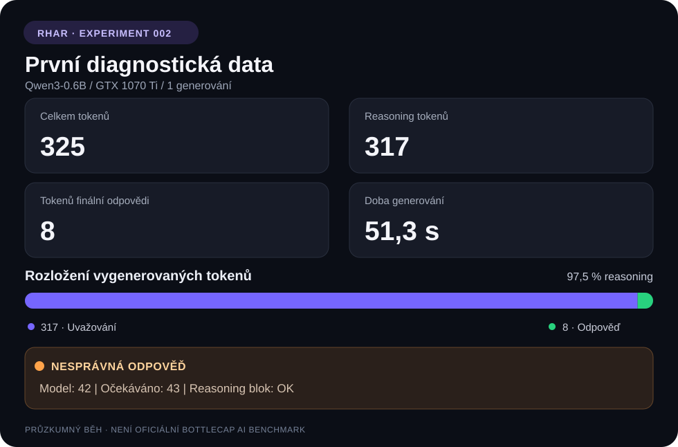

# 🔬 RHAR — Experiment 002: První diagnostická data

[🇨🇿 Čeština](002-reasoning-baseline.md) · [🇬🇧 English](../../docs/experiments/002-reasoning-baseline.en.md) · [Vývojový deník](../DEV-NOTES.md)

## 📊 Naměřené hodnoty

| Metrika | Naměřeno |
| --- | ---: |
| Celkem generovaných tokenů | **325** |
| Reasoning tokeny (včetně hranice) | **317** |
| Tokeny finální odpovědi (včetně ukončení) | **8** |
| Podíl reasoning tokenů | **97,54 %** |
| Doba generování | **51,3 s** |
| Průměrná rychlost | **6,33 tokenů/s** |
| Odpovědi / správné odpovědi | **1 / 0** |
| Úspěšně oddělený reasoning blok | **1 / 1** |

**Hodnocení tohoto jednoho vzorku:** ❌ Nesprávná odpověď. Nejde o přesnost modelu napříč úlohami ani o oficiální benchmark.

## 🔎 Ověření uloženého záznamu

| Pole | Hodnota |
| --- | --- |
| Test | `arithmetic_apples` |
| Správná odpověď | `43` |
| Výstup modelu | `Final answer: 42` |
| `correct` | `false` |
| `grading_error` | `null` |
| `truncated` | `false` |
| `split_status` | `generated_think_block` |

Záznam uživatel ručně načetl ze souboru `records.jsonl`. Hodnoty ukazují, že **formát i hranice reasoning procesu byly rozpoznány**, ale výsledné číslo je chybné. `grading_error: null` neznamená úspěch; pouze nebyla ohlášena chyba formátu.

### ⚠️ Otevřená otázka: vliv formátového příkladu

Diagnostický prompt obsahoval ukázku `Final answer: 42`, a model pak skutečně vrátil `42`. **Shoda je podezřelá, ale neprokazuje příčinu chyby.** Bez kontrolního experimentu nerozlišujeme chybu počítání od možného opsání ukázkového čísla. Žádný prompt v tomto experimentu modelu nepřikazoval zkrátit reasoning a thinking zůstal zapnutý.

## 🧪 Původ a omezení

- **Datum běhu:** 2026-10-09, identifikátor `20261009T210123Z` (UTC).
- **Model:** původní `Qwen/Qwen3-0.6B`, bez trénování RHAR.
- **Prostředí:** Kali Linux / WSL2; NVIDIA GTX 1070 Ti.
- **Lokální artefakty:** `runs/diagnostics/20261009T210123Z/` na počítači vlastníka.
- **Důkaz:** souhrn a vybraná pole záznamu poskytnutá vlastníkem. Úplný reasoning trace jsme nepřenášeli.
- **Stav:** průzkumná diagnostika, **nikoli** oficiální BottleCap AI benchmark, kalibrace HRM, důkaz úspory tokenů ani implementace RPS/RPD/TPC.
- **Neporovnávat s předchozím během 371 tokenů jako se zlepšením:** lišily se konkrétní podmínky a neexistuje doladěný kandidátní model.

## 🐇 Následující navržený krok

Po schválení vlastníkem odstranit zavádějící ilustrační hodnotu z diagnostického promptu (zachovat pouze definici formátu finální odpovědi), otestovat hodnoticí logiku a provést nový jasně označený kontrolní běh. **Oficiální benchmarkové prompty beze změn.**

## 📐 Jednotný vzhled budoucích reportů

Každé další měření zapisujeme v **CZ/EN dvojici**: grafický panel s metrikami, poměr reasoning/final tokenů, přiznaný stav správnosti, tabulku skutečných hodnot, identifikátor běhu, chyby a omezení. Graf musí vždy vycházet z reálně doložených dat. Pokud je rozdělení tokenů neznámé, žádné procento nedopočítáváme. SVG je jen vizuální vrstva; tabulka zůstává čitelná i bez obrázku.
