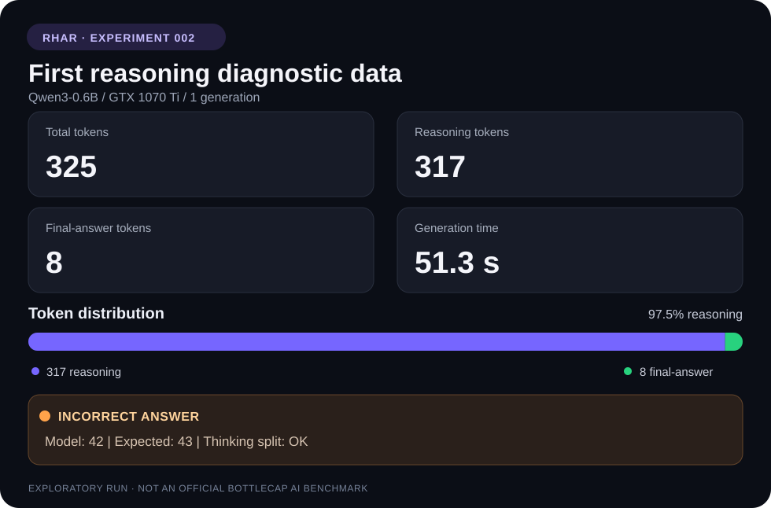

# 🔬 DEV-NOTES — Development diary

[🇨🇿 Česky](../CZ%20docs/DEV-NOTES.md) · [🇬🇧 English](DEV-NOTES.en.md)

## Collaboration rules

- **I make the final decisions about major technical changes, experiments and ideas.** Before a substantial change, we discuss options, risks and the next steps.
- I do not change research direction, model, training strategy, benchmark settings or project structure without making an explicit decision first.
- Routine documentation updates and technical fixes within an explicitly approved scope can proceed if clearly recorded in the diary.
- Distinguish **completed / verified / proposed / awaiting approval / failed**. Never fabricate test success or benchmark results.
- Entries must include date, changes, rationale, verification, and next step. Material decisions must have an explicit approval status.
- **No step forward without green tests** for code changes; verify structure and links for documentation changes.

## Diary

### 2026-10-10 — 📚 What I learned today: from SFT to safe CEP 002 (daily recap)

**Entry type:** lessons from today's work; summary of experiments already performed and an independently **proposed** algorithm, not new measurements or a working CEP 002 implementation.

- **A model can fail because it loses the relationships between constraints, not because it cannot recognize a number.** In the 536 lock-code task, plain SFT 003 correctly derived `(Y+2)+3Y=14` and finished in 139 tokens. CEP Pilot 001, which increased lexical weights for numbers and operators, used 244 tokens and mentioned the correct candidate but ultimately selected the wrong 312. Emphasizing numeric tokens, shortening text, or merely mentioning a correct intermediate answer is insufficient: the full derivation and final answer must agree.
- **I must measure correctness and token usage together, using paired comparisons.** On six diagnostic tasks SFT scored 3/6 versus CEP 2/6; on a separate set of 20 tasks both scored 9/20. Evaluation 006 (60 other mathematics tasks, one seed) gave SFT 19/60 and 5,769 generated tokens versus CEP 001 23/60 and 5,266 tokens (503 / 8.72% fewer). CEP fixed eight answers but broke four that SFT got right. **This local sample is encouraging, not proof of cross-domain transfer, official benchmark performance, or robust improvement.**
- **Experimental isolation matters as much as the algorithm.** I learned to check which LoRA adapter is active: reusing an already PEFT-decorated backbone can compromise the comparison. Evaluation 006 loads each adapter onto a separate clean backbone. Record the seed, matched prompts, generation limit, completion state, and intermediate artifacts; the 60 already inspected questions cannot become a fresh independent holdout or training set retroactively.
- **CEP 002 is not “memorize every answer.”** The target is a *verified procedure*: task facts → necessary dependencies → applicability and constraint checks → final answer. **VPS** independently checks steps, **XP** records both successful and failed methods with the reason and may select up to three verified applicable candidates, and **REC** allows a newly supported insight to trigger rechecking an older training example. If solution 10 appears to expose an error in solution 3, that alone is not proof: the original case must be independently checked again.
- **Newer answers are not automatically more truthful.** **Verified Lock** protects independently checked earlier solutions from false “corrections.” A new assertion triggers review only; changing the locked result needs independent evidence and a versioned repair. Conflicting verification evidence requires a hold and exclusion from new training, not deletion of the history. The verifier is not infallible either.
- **The goal is to improve model weights, not build unnecessary infrastructure around them.** CEP 002 is currently a design for offline processing of permitted training data followed by standard LoRA. Qwen must run without external inference-time memory or a custom orchestrator, while the official BottleCapAI evaluation remains untouched. Related published methods exist, so novelty and gains remain unproven.

**What was actually verified:** SFT 003 and CEP Pilot 001 have been locally evaluated; earlier entries contain the CPU/GPU details and measurements. **What remains a proposal:** CEP 002 (VPS + XP + REC + Verified Lock); no implementation, CEP 002 LoRA run, CEP 002 CPU unit tests, or independent experiment has taken place. An older “End of day” entry further below describes an **earlier CPU-preflight phase**, not the final state of October 10.

**Next step — proposed only, requires separate approval:** a small CPU verifier prototype on 10–20 manually checked permitted training cases, false-correction and evidence-conflict tests; only then a controlled A/B/C comparison of plain SFT, VPS+XP, and VPS+XP+REC on a fresh untouched sample. **No step forward without green tests.** 🐇🛡️

### 2026-10-10 — 🛡️ CEP 002 v0.3: Verified Lock — protecting independently verified experiences

**User decision:** include a safety guard to prevent a later incorrect Qwen answer from being accepted as truth and used to retroactively corrupt an earlier correct answer.

**Documented design:** Verified Lock is **not a fourth architecture service**; it is a VPS + REC state invariant. A complete trace becomes VERIFIED_LOCKED only with trusted original facts, independently verified intermediate steps, correct final and normal completion, recording contract hash and verifier version. Later Qwen outputs can only trigger RECHECK_PENDING. Original still checks out → REJECTED_CORRECTION; demonstrated mistake plus independently validated repaired procedure → append a versioned correction without overwriting history; disputed contract/verifier → LOCK_DISPUTED / REVIEW_REQUIRED and exclusion from new training examples. The verifier itself is not guaranteed infallible.

**Documentation:** updated Czech [CEP-002.md](../CZ%20docs/CEP-002.md), English [CEP-002.en.md](CEP-002.en.md), and both IDEA files. Pseudocode excludes disputed records from training. Proposed CPU tests for false corrections, ambiguous evidence, verifier conflicts, accidentally correct final answers with flawed reasoning and preservation of prior versions. Track false_correction_proposals, accepted_verified_repairs and disputed_locks.

**Status:** **PROPOSAL ONLY**; no working Verified Lock, new generations, new CEP 002 CPU unit tests, GPU, or LoRA training. Implementations/experiments need separate approval. BottleCapAI compatibility is maintained by offline permitted-training-data processing with no extra official inference-time memory or changed evaluator.

### 2026-10-10 — 🧠 RHAR-CEP 002 v0.2: simple VPS + XP + REC design (proposal only)

**User decision:** flesh out CEP 002 with my idea of protecting indispensable reasoning dependencies, **without creating an unnecessarily complex system**. Show a readable version of the algorithm directly in the conversation and record the specification in Czech and English.

**Actually completed:** [CEP-002.en.md](CEP-002.en.md) and [Czech](../CZ%20docs/CEP-002.md), linked from both IDEA files and both READMEs. The three MVP components are **VPS** (deterministic verification of task constraints and intermediate relations), **XP** (at most three actually existing verified applicable strategies) and **REC** (a newly verified insight may trigger rechecking an earlier *training* example; its original trace is immutable). Training targets should follow **task facts → necessary dependencies → applicability check → final answer**, not arbitrary text shortening.

**Deliberate simplicity:** one batch CPU verifier, JSONL records, 10–20 manually reviewed permitted training examples for future tests, and ordinary LoRA. No vector store, multi-agent inference system, RL/DPO, automatic online training or custom inference controller.

**Experiment proposed only:** A = conventional SFT, B = VPS+XP, C = VPS+XP+REC; use matched conditions and fresh untouched validation to isolate C versus B, measuring strict accuracy, generated tokens, completion and false corrections. The 60 previously inspected Evaluation 006 questions are not a fresh independent holdout; exclude official SVAMP/MBPP+/BFCL/IFEval questions from training. Preserve standard Qwen/LoRA loading and official evaluation settings.

**Status:** specification documented; **CEP 002 is not implemented, tested, trained or proven scientifically novel**. No new CEP 002 CPU tests, GPU action, model generation or training was performed. Implementation and execution require separate explicit approval.

### 2026-10-10 — 🧠 CEP 002: proposed REC (Retroactive Experience Correction) added

**User decision:** extend the CEP 002 research direction with **REC — Retroactive Experience Correction**. A newly verified solution on a later *training* question may trigger a recheck of an earlier saved solution (e.g. question 10 → recheck question 3). The base model does not automatically recognize its past error: explicit records, a revisit trigger and independent verification are required. This is not online updating of the model weights during inference.

**Proposed mechanism:** immutable and versioned solution history, up to three genuinely available independently verified applicable strategies, intermediate-step verification, preserved errors and corrections (XP+, XP−, REC), transfer to other permitted training variants and only then potentially approved LoRA training with a fresh holdout. Never overwrite historical model responses. An LLM judge alone is not sufficient proof.

**BottleCapAI compliance:** reviewed original `docs/UPSTREAM-README.md`: post-training methods and LoRA are permitted, but the final standard Transformers/vLLM Qwen3-0.6B/LoRA must run without any custom REC runtime component; keep thinking enabled and the official evaluation unchanged. Do not train on SVAMP, MBPP+, BFCL or IFEval. The 60 previously reviewed Evaluation 006 questions cannot simultaneously be training examples and an independent test. Prefer other allowed training questions for REC.

**Actually done:** proposal added to both `CZ docs/IDEA.md` and `IDEA.md`, plus this diary update. **Not done:** REC implementation, REC CPU/GPU testing, new model generations or CEP 002 training. Any execution requires separate approval.

### 2026-10-10 — 🐇 GPU Canary 002 and RHAR 003–007: lessons, bugs and fixes

**Status:** documented local outputs and implemented changes. No training, weight changes, official benchmark or proven token savings. Original `runs/` artifacts remain untouched.

#### 🖥️ Preflight and the first correct inference

- Kali/WSL2 initially passed `Ran 190 tests`, `OK (skipped=2)`. After RHAR 006 fixes, the full suite passed `Ran 213 tests in 1.255s`, `OK (skipped=2)`. Skips are not failures; inspect their reasons before official evaluation.
- GTX 1070 Ti 8 GB: PyTorch `2.6.0+cu118`, CUDA available, compute capability `6.1`, actual FP16 computation OK. The local Qwen3-0.6B snapshot is pinned to `c1899de289a04d12100db370d81485cdf75e47ca`.
- GPU Canary 002 (`runs/canary-002/20261010T102914Z/`) finished with exit code 0: `arithmetic_apples`, seed 9001, correct final answer 43, not truncated, **423 generated tokens = 415 reasoning + 8 final**, 82.552 s, 5.124 tokens/s and 1.185 GiB peak PyTorch allocation. The older Experiment 002 answered 42 incorrectly in 325 tokens and 51.3 s; these are not controlled evidence of improvement.
- A temporarily quiet terminal and idle `nvidia-smi` snapshot were not sufficient to infer a hang. The saved run records and exit code resolved the uncertainty.

#### 🧠 Offline analyses

- **RHAR 003:** 265 reasoning words, five paragraphs, three repeated four-grams, reasoning share 98.11%. Surface repetition does not prove removable reasoning.
- **RHAR 004:** four sections were flagged for manual review. An earlier segmenter returned 27 steps; the corrected numeric sentence splitting returned 33 on the same text. Text steps are not token counts.
- **RHAR 005:** six explicit operations were detected, including two repeats: `5 times 10` / `10*5` and `5 times 2` / `2*5`. The parser does not cover every natural-language form.
- **RHAR 006:** all six detected operation claims were arithmetically consistent. The answer candidate `43 apples remaining` ended at character offset 646; 616 more reasoning characters followed. This is not a proven safe early-stop location.
- **RHAR 007:** pinned-tokenizer offline retokenization produced 423 tokens, matching the saved count. The candidate falls on retokenized boundary 200, followed by 223 retokenized tokens. Status: `retokenized_boundary_only`. Original generated token IDs are unavailable. **223 is not measured or guaranteed savings.** `measured_token_savings=null`; `early_stop_safety_verified=false`.

#### 🐛 Bugs and resolutions

1. `test_arithmetic_consistency` returned `[None, None]` rather than `[True, True]`, and `test_detect_wrong_arithmetic` returned `None` rather than `False`: the numeric-result regex rejected a trailing sentence period. Fix: accept punctuation as a numeric boundary.
2. `test_arithmetic_and_repeat` produced two steps instead of three because sentence splitting only admitted an uppercase letter after punctuation. Fix: also admit a digit. This changed step numbering (27 versus 33) without changing model behavior.
3. RHAR 004 equation matching missed operations written as words. RHAR 005 normalized `times`, `*`, `×`, `minus` and related forms while keeping redundancy explicitly unproven.
4. RHAR 006 refined answer-candidate phrasing such as `43 apples remaining`; RHAR 007 introduced fail-closed outcomes for retokenization mismatches, ambiguous offsets and checkpoints inside tokens.
5. After `Ran 213 tests`, `FAILED (failures=3, skipped=2)`, we stopped advancing. The full local suite subsequently passed before further experiments.

#### ✅ Lessons and next step

- Characters, paragraphs, heuristic repetitions and first correct-answer mentions cannot be equated with saved generated tokens. Accuracy and actual generation counts must be assessed together.
- Fixed revision, seed, local output artifacts and separation of GPU from CPU-only analysis improve traceability.
- **Proposed RHAR 008:** save original generated token IDs and validation metadata in future diagnostics, test integrity, then investigate actual token boundaries. Not yet implemented or authorized.
- CPU CI was added to the feature branch; local tests are green, but no newly successful CI run is claimed without evidence.

**Summary:** 213 tests executed (two skipped), one correct GPU canary, offline RHAR 003–007, three fixed regression failures, **zero demonstrated token savings and zero training runs**. 🐇🛡️

### 🌙 2026-10-10 — End of day / What we learned today

**Status: work is finished for today.** Our objective was not to train Qwen, but to build a safe, reproducible preparation pipeline for **RHAR — Rabbit Hollow Adaptive Reasoning**. We began with a CPU-only planner and finished with **103/103 green tests** (`Ran 103 tests in 0.917s`, `OK`) and a verified generation `--dry-run`. This is a genuine preparation result, **not** measured token savings.

**What we actually completed:** using a pinned revision of `openai/gsm8k` on Kali, we checked the training Parquet SHA-256, loaded **7,473** records, and deterministically selected **twelve candidate math questions**. We prepared the frozen **12 × 3 = 36** future-generation plan for `Qwen/Qwen3-0.6B`, with seeds `9001, 9002, 9003`, thinking enabled, temperature `0.6`, top_p `0.95`, top_k `20` and `512` maximum new tokens. The future runner validates the original twelve IDs, input hashes and completed overlap-screen report. Over the course of the day the complete CPU test suite grew **45 → 61 → 79 → 103**, and each updated complete suite was confirmed green.

**What today's work taught us:**
- **Reproducibility is foundational.** Pinned dataset/model revisions, SHA-256, fixed seeds and stable prompts are necessary for meaningful comparison. Gold answers belong only in grading, **never in the model prompt**.
- **Dependency mismatches can block even simple CPU operations.** `pyarrow` was initially absent; a newer version then required NumPy 2.x while Kali used NumPy `1.26.4`. We resolved this narrowly with compatible `pyarrow==16.1.0`, rather than blindly upgrading the AI environment.
- **Zero matches do not prove a contamination-free dataset.** We compared twelve GSM8K questions with **2,759 prompt texts** from six pinned SVAMP, MBPP+, BFCL and IFEval source objects. We found **zero exact or strong heuristic near-duplicates** in that defined screen, but **semantic paraphrases are not ruled out**, so all candidates remain `review_only`.
- **Thinking-token accounting must count real generated tokens.** We distinguish reasoning and final tokens, handle chat-template-prefilled `<think>`, `</think>` boundaries and termination tokens. `reasoning_tokens + final_tokens` must equal all generated tokens when the split is known. Unknown is not zero; incomplete or incorrect outputs must not be counted as successful.
- **Green CPU tests validate preparation, not the model's reasoning quality.** The dry run checked all three local inputs and the fixed execution plan, but **did not load Qwen, use GPU, generate model answers or train anything**. There is no RHAR efficiency measurement or proven model improvement yet. Shorter does not automatically mean correct.

**Research lesson:** a small, auditable experiment with stop conditions beats a costly unguarded run. We must keep **preparation → CPU verification → GPU inference → possible training** under separate explicit approvals. The future GPU runner requires two explicit CLI flags; neither is authorization without a separate decision.

**Next session (planned, not executed):** CPU-only preflight of the local Qwen cache, CUDA/FP16 and available VRAM, plus a proposed time budget, progress persistence and stopping criteria. Only after that will I separately decide whether to allow a short canary or all **36 generations**. **No GPU inference, LoRA/training or official benchmark happened today, and none is automatically authorized for the next session.**

**Final daily scoreboard:** **103/103 CPU tests green · 12 validated candidates · 2,759 evaluation prompts screened · 0 heuristic matches · 36 planned generations only · 0 GPU runs · 0 training runs.** 🐇🛡️

### 2026-10-10 — ✅ Safe Start generator: 103/103 CPU tests green on Kali

**Actually verified on my Kali/WSL2:** the combined `tests.test_offline_selector`, `tests.test_reasoning_probe`, `tests.test_safe_start_plan`, `tests.test_safe_start_data`, `tests.test_safe_start_overlap`, and `tests.test_safe_start_generate` suite reported `Ran 103 tests in 0.917s`, `OK`. This closes the CPU test gate, **not** an actual GPU experiment.

**Actual command:** `python -m diagnostics.safe_start_generate --dry-run` confirmed `status=plan_only`, model `Qwen/Qwen3-0.6B` at revision `c1899de289a04d12100db370d81485cdf75e47ca`, `thinking_enabled=true`, 12 existing pinned GSM8K train candidates × 3 seeds (`9001,9002,9003`) = **36 planned generations**, temperature 0.6 / top_p 0.95 / top_k 20, and `max_new_tokens=512`.

**SHA-256 of the three existing local inputs from the verified dry run:** `questions=ebb3595c677ec6a660da3ff8731448182674967beab4d5e7f5256347541d32bc`; `selection_report=0760c4825de4e18bbbfcb6429dd543dcfa7fcc9e18dae83a118bccdf2b3cb89a`; `overlap_audit=7b9443abf9e2960084bfaf6472ddf049ff057d4f4e1c889a4c01902a2ccc7ca4`. These bind the dry run to the local inputs and screen but cannot prove semantic-paraphrase contamination is absent.

**Explicit boundaries:** `gpu_used=false`, `model_loaded=false`, `model_downloaded=false`, `training_performed=false`, `training_approved=false`, `official_benchmark=false`, `model_generations_performed=0`. **No new model output or token-saving measurement has occurred.**

**Next decision requires separate approval:** review the time/GPU budget, local model-cache preflight, and stop conditions before any 36-sample CUDA run, potentially allowing only a small canary if expressly approved. Do not execute GPU yet; candidates remain `review_only`.

### 2026-10-10 — 🐇 RHAR Safe Start: GPU runner prepared, execution NOT authorized

**My approval:** after `Ran 79 tests in 0.832s` / `OK` and the 12-candidate screen against 2,759 official evaluation prompts (zero heuristic text matches but semantic paraphrases not ruled out), I approved **only implementing a future GPU runner and CPU unit tests**. **No new GPU inference, model downloads, or training were authorized or performed.**

**Added:** `diagnostics/safe_start_generate.py` and `tests/test_safe_start_generate.py` (**24 new test methods**). The runner binds its inputs to the twelve original question IDs and hashed review manifests, verifies all six reported official source records, and refuses incomplete or matching audits. It reuses frozen Safe Start settings: Qwen3-0.6B and pinned model revision, seeds 9001/9002/9003, thinking enabled, 0.6/0.95/20 sampling, and 512 new tokens maximum. Gold answers and shortening instructions are excluded from prompts.

**Safeguards:** `--dry-run` never loads the model, uses CUDA or downloads files. Future sampling requires **both** `--execute` and `--confirm-gpu-36` **plus my separate future approval**. GPU execution only uses already cached weights (`local_files_only=True`) on CUDA float16; no background download. Reasoning and final counts cover every actually generated token; incomplete or incorrect answers cannot be treated as correct. A partial result is not reported as a successful 36-sample run. Output directories are fresh/ignored and never overwritten. Generated records are intended only for offline `diagnostics/offline_selector.py` review, not training.

**Verification:** an isolated local prototype passed **23 CPU-only tests using minimal stubs**, but **the exact new 24-test GitHub suite and the full 103-test Kali suite are not yet confirmed on the user's machine**. Expected total 103 = previous 79 + new 24. Do not advance without actual green Kali tests.

**Documentation:** [SAFE-START-GENERATION.en.md](SAFE-START-GENERATION.en.md) / [Czech](../CZ%20docs/SAFE-START-GENERATION.md). Next step: run all 103 CPU tests and `python -m diagnostics.safe_start_generate --dry-run` only; no GPU command.

### 2026-10-10 — ✅ RHAR Safe Start: 79/79 combined CPU tests green on Kali

**Actual terminal output:** `Ran 79 tests in 0.832s` and `OK`. The entire 79-test CPU suite ran together on my Kali/WSL2 environment: offline selector, reasoning probe, Safe Start planner, GSM8K data selection, and the new overlap audit. This is the first evidenced **full combined** run of the current suite on Kali.

**Previously verified overlap screen:** `python -m diagnostics.safe_start_overlap --download` screened the twelve pinned GSM8K candidates against **2,759 prompt texts** across six SVAMP, MBPP+, BFCL and IFEval files. It returned **zero textual matches** under the implemented heuristic. `semantic_paraphrases_ruled_out=false` and `overlap_audit_exhaustive=false`, so the result does not prove that no semantic paraphrases overlap.

**Completed gate:** CPU preparation, twelve candidate questions, 36 future planned attempts, file integrity screening, and regression testing are green. No new Qwen3-0.6B generations, GPU use, model training, or official benchmark execution occurred. `review_only` and `training_approved=false` remain unchanged.

**Next decision (NOT yet approved):** separately review compute budget, stop conditions, and the implementation of the first proposed GPU sampling phase: **12 questions × 3 seeds = 36 generations**, no LoRA and no automatic training-data authorization. **Do not start GPU work without my consent.**

### 2026-10-10 — ✅ Actual CPU overlap screen: 0 matches among 2,759 evaluation prompts

**Actually completed on Kali / WSL2:** `python -m diagnostics.safe_start_overlap --download` succeeded and returned `audit_result=no_matches_in_screened_sources`. It checked the **twelve previously selected GSM8K train candidates** (pinned revision `740312add88f781978c0658806c59bc2815b9866`) against **2,759 prompt texts** from all six declared files across four benchmark families.

**Observed counts:** SVAMP 1,000; MBPP+ 378; BFCL simple_python 400; BFCL multiple 200; BFCL irrelevance 240; IFEval 541. **Zero exact or heuristic near-duplicate matches** were reported; `potential_matches=[]`. Known content SHA-256 pins passed for SVAMP and MBPP+. Observed hashes of the commit-pinned BFCL files were `82dd63ba502eb2520c6b5d1d9a5c4b590e03ff261565175561f6228a367d1991`, `aef168155ebd74b7ac2401198b201343bc7d16d7a3d7e0d4e6d8ee82c6969b2a` and `2b6ed4c2e992cdcf5f1678a701851f944bef7550ee026ed1ddb89efed5be01a6`. The IFEval hash was `67ffeee0fcb87c317c5b08a2de85557b4a7e96ada6178aa645b4954fe4b53d49`. For BFCL and IFEval these hashes were **recorded, not prechecked against independent known values** (`known_sha256_pin_checked=false`).

**Interpretation:** this is a negative match result **within the six declared datasets under the implemented similarity rule**. It does **not** establish zero contamination or exclude semantic paraphrases (`semantic_paraphrases_ruled_out=false`, `overlap_audit_exhaustive=false`). Candidates remain `review_only`, `training_approved=false`, and no original files were changed. **No inference, GPU, training, or official evaluation** took place (`gpu_used=false`, `model_generations_performed=0`, `training_performed=false`, `official_benchmark_run=false`).

**Test gate:** 61/61 earlier CPU tests were confirmed, but **the combined new 79/79 suite has not been demonstrated in this latest user terminal output**. Wait for a successful complete suite before any new experimental approval. GPU sampling and training require separate explicit authorization.

### 2026-10-10 — 🛡️ Approved CPU-only overlap screen of 12 GSM8K candidates against official evaluation questions

**Decision:** after **61/61 CPU tests passed on Kali (`Ran 61 tests in 0.600s`, `OK`)** and confirming `questions/questions.jsonl` was absent, I explicitly authorized **only preparing and downloading pinned official evaluation data for contamination screening**. No inference, GPU, training or official evaluation run is approved.

**Implementation:** separate `diagnostics/safe_start_overlap.py` and `tests/test_safe_start_overlap.py`. The auditor checks exactly six source objects across four benchmark families (SVAMP, MBPP+, three BFCL v4 categories, IFEval) using the source revisions from the **unchanged** `utils/eval/benchmarks.py`. Known content SHA-256 pins are checked for SVAMP and MBPP+. BFCL and IFEval are Git-commit-pinned and their observed file hashes are recorded. Only question/prompt text is extracted for matching, never official gold answers. The regular evaluation downloader and graders are not run.

**Safeguards:** before any network request, validate our **existing twelve selected questions** against their original manifest: IDs and SHA-256. Do not automatically reselect examples. Missing sources, checksum mismatches or malformed data cause a failure without a green report. The ignored `data/safe-start/overlap-audit.json` contains only evidence, counts, hashes, and potential-match indices. It does not claim paraphrase-proof screening or authorize training.

**Verification:** the **18/18** new unit tests passed **in an isolated local CPU environment with mocked network data**. GitHub copies of the two Python files were verified against the tested files. **A full 79/79 Kali run and the actual six-source audit are still pending**. No model or GPU was run.

**Documentation:** [SAFE-START-OVERLAP.en.md](SAFE-START-OVERLAP.en.md) / [Czech](../CZ%20docs/SAFE-START-OVERLAP.md). Next: synchronize the branch, run all CPU tests, only then run `python -m diagnostics.safe_start_overlap --download`, inspect its report, and obtain separate approval before any additional experiment.

### 2026-10-10 — ✅ Complete Safe Start CPU suite 61/61 OK; local eval corpus missing

**Actual output from my Kali/WSL2:** after synchronizing `feat/reasoning-compression`, I ran `tests.test_offline_selector`, `tests.test_reasoning_probe`, `tests.test_safe_start_plan` and `tests.test_safe_start_data` together. The terminal reported **`Ran 61 tests in 0.600s`** and **`OK`**. This verifies the complete current CPU suite, not merely separate 45- and 16-test runs.

The command `test -f questions/questions.jsonl` reported **`Eval otázky chybí`** (evaluation questions missing). The earlier real selection report remains `overlap_audit_status=pending_local_eval_corpus`, `local_eval_audit_performed=false`, and `overlap_audit_exhaustive=false`. **Zero filtered overlaps without an evaluation corpus do not establish absence of data contamination.**

**Completed scope:** CPU schema validation, verified cached GSM8K train ingestion, selection of twelve review candidates and a plan for 36 *future* attempts. **Neither performed nor authorized:** fetching official evaluation data, running the official benchmark, GPU inference, LoRA/training, or measuring token savings.

**Next approval:** separately authorize an overlap check against accurately pinned official evaluation prompts. Running the existing `utils/eval/benchmarks.py` directly would fetch additional dependencies and assemble the full benchmark; do not do this automatically. All twelve candidate questions remain `review_only`.

### 2026-10-10 — ✅ GSM8K Safe Start: real CPU selection of 12 questions confirmed on Kali

**Actual terminal output:** `Ran 16 tests in 0.512s`, `OK` for `tests.test_safe_start_data`. Running `python -m diagnostics.safe_start_data --download` successfully processed **7,473 records** from pinned GSM8K `main/train` revision `740312add88f781978c0658806c59bc2815b9866`. The report included `download_status=verified_cached` and SHA-256 `ea82612ea9582142387730c793eb67d3b12849002bc0b7fa6f8efafa7351419d`.

**Selected question IDs (ordered):** `gsm8k-train-06982, gsm8k-train-01136, gsm8k-train-06866, gsm8k-train-02829, gsm8k-train-01500, gsm8k-train-01015, gsm8k-train-01832, gsm8k-train-03268, gsm8k-train-06657, gsm8k-train-06089, gsm8k-train-02730, gsm8k-train-01217`. The local `selection-report.json` also stores every question's SHA-256, while the question text and gold answers remain inside ignored `data/safe-start/questions.jsonl`.

**Verified dry run:** `python -m diagnostics.safe_start_plan --dry-run --questions data/safe-start/questions.jsonl` validated twelve records and planned **36 attempts** (seeds `9001/9002/9003`, Qwen3-0.6B, thinking enabled). **No inference, GPU sampling, or model training occurred**; all selected examples remain `review_only` and `training_approved=false`.

**Unfinished audit:** `overlap_audit_status=pending_local_eval_corpus`, `local_eval_audit_performed=false`, `overlap_audit_exhaustive=false`. The absence of filtered candidates **does not establish the absence of evaluation contamination**. Do not download evaluation data or launch GPU without separate approval.

**Dependency fix:** importing a too-new PyArrow initially failed with NumPy 1.26.4. After the compatible-version installation recommendation, the real CPU selection succeeded. I therefore pinned `pyarrow==16.1.0` in `requirements.txt`. The complete combined **61/61 test run on Kali has not yet been observed**: the earlier 45/45 and current 16/16 are distinct executions.

### 2026-10-10 — 🐇 Approved GSM8K train CPU download and 12-question selection

**My decision:** after **45/45 CPU tests in 0.045 s** passed on Kali and the `safe_start_plan --dry-run` showed `plan_only`, 12 questions, 36 proposed attempts and `gpu_used=false`, I authorized **only downloading pinned GSM8K main/train and deterministically selecting 12 candidate questions on CPU**. GPU sampling, LoRA, model training and automatic acceptance of selected examples remain unauthorized.

**Implemented:** `diagnostics/safe_start_data.py` and `tests/test_safe_start_data.py` (16 new unit tests). The dataset revision is pinned to `740312add88f781978c0658806c59bc2815b9866`; only `main/train-00000-of-00001.parquet` is downloaded, with expected SHA-256 `ea82612ea9582142387730c793eb67d3b12849002bc0b7fa6f8efafa7351419d`. Selection uses fixed SHA-256 ordering and screens for malformed numeric gold, duplicates and obvious overlaps with an optional existing local eval question file. Official evaluation is unchanged. Artifacts under `data/safe-start/` remain `review_only` and are not training-approved.

**Verification:** 16/16 new CPU unit tests and the previous 15 planner tests (**31/31**) passed in an isolated local environment. Network I/O was mocked for the tests; **the real GSM8K download on my Kali and the combined new 61/61 suite are still pending**. The two new GitHub Python files were confirmed to match the locally tested versions.

**Procedure:** [SAFE-START-DATA.en.md](SAFE-START-DATA.en.md) / [Czech](../CZ%20docs/SAFE-START-DATA.md). I must first run all CPU tests on Kali, then, if green, execute `python -m diagnostics.safe_start_data --download`, inspect `selection-report.json` and verify the 12 real question IDs. Without local evaluation questions the overlap audit remains `pending_local_eval_corpus`; **I cannot claim the absence of contamination**.

### 2026-10-10 — 🐇 RHAR Safe Start approved, CPU plan and tests ready

**My decision:** I approved a small initial pilot of **12 math questions × 3 planned generations**, but at this stage authorized **only the implementation plan, CPU validation and unit tests** — not dataset downloads, GPU inference or training.

**Implemented:** `diagnostics/safe_start_plan.py` and `tests/test_safe_start_plan.py`. The planner produces exactly 36 *proposed* attempts with seeds 9001/9002/9003, pinned Qwen3-0.6B, thinking enabled, sampling 0.6/0.95/20 and 512 max output tokens. A future manually supplied dataset must pass the exact 12-record GSM8K/train/math contract with a pinned 40-hex revision. Unknown fields, malformed answers, duplicates, evaluation-source labels and incorrect splits are rejected. There are no network calls or generation operations.

**Verified:** **15/15 new CPU tests passed** in an isolated local environment; `python -m diagnostics.safe_start_plan --dry-run` reports `status=plan_only`, `planned_generations=36`, `gpu_used=false`, `dataset_downloaded=false`, `training_performed=false`. This used a local replica of original diagnostic constants rather than a full GitHub checkout.

**Prior phase:** 30/30 selector and diagnostic CPU tests passed on Kali. **The new combined 45-test suite has not yet been confirmed on Kali**; I must pull the branch and run the combined test command.

**Documentation:** [SAFE-START.en.md](SAFE-START.en.md) / [Czech](../CZ%20docs/SAFE-START.md) records the implementation contract, settings, stop rules, rough runtime estimate and approval boundaries. No real dataset questions were fetched. A source-name string check alone cannot rule out evaluation contamination.

**Not performed:** no new model output, GPU use, LoRA, weight modification, official benchmark or demonstrated token savings. **Next:** run 45 CPU tests on Kali and separately approve exact questions and their provenance before touching GPU.

### 2026-10-09 — ✅ RHAR v0.1: 30/30 CPU tests confirmed

**Actually verified on my Kali / WSL2 system:** after correcting compatibility with legacy diagnostic records, I ran the combined selector and reasoning diagnostic unit test suite. The terminal reported:

- `Ran 30 tests in 0.023s`
- `OK`

**Result:** **30/30 tests passed**, with no reported errors or failures. This comprises **20 tests in `tests.test_offline_selector` and 10 in `tests.test_reasoning_probe`**. **0.023 s** is the `unittest` CPU test runtime, not inference or training performance.

**Separately verified actual offline run:** `runs/offline/20261009T214634155051Z/` against `runs/diagnostics/20261009T210123Z/records.jsonl` correctly reported `incorrect_answer: 1`, `correct_final_answers: 0` and `selected_for_review: 0`. Input SHA-256 `bf9360243279dd0a6636111c955492018521b00e18a390f3770ae36caab25de0`. The earlier incorrect diagnostic observation is preserved.

**Interpretation and evidence boundary:** RHAR v0.1's initial **offline / CPU phase** now has a confirmed passing regression suite plus a real historical-record check. **I have not trained Qwen, modified model weights, performed a new GPU inference, run the official benchmark or demonstrated token savings.** A correct final answer alone cannot validate the entire reasoning trace.

**Next step, not performed:** decide on a specific protocol, compute budget and validation gates for collecting permitted training examples. I will explicitly approve the concrete experiment before running generation or training.

### 2026-10-09 — ✅ Fixed offline selector verified on Kali

**Actually performed:** after fixing compatibility with legacy diagnostic records, I reran `python -m diagnostics.offline_selector runs/diagnostics/20261009T210123Z/records.jsonl` on my Kali / WSL2 system. No new inference or training was performed.

**Observed summary values:**

| Metric | Value |
| --- | ---: |
| `records` | **1** |
| `correct_final_answers` | **0** |
| `training_eligible_candidates` | **0** |
| `selected_for_review` | **0** |
| `reasons` | `{"incorrect_answer": 1}` |
| `no_training_performed` | `true` |
| `official_benchmark` | `false` |
| `review_only` | `true` |

**Provenance:** input `runs/diagnostics/20261009T210123Z/records.jsonl`, SHA-256 `bf9360243279dd0a6636111c955492018521b00e18a390f3770ae36caab25de0`; output `runs/offline/20261009T214634155051Z/`. The matching SHA-256 across both offline runs confirms that the same input bytes were reviewed.

**Interpretation:** unlike the first offline run, which returned `invalid_question_metadata: 1`, this run recognized the known `arithmetic_apples` case and correctly reported the **incorrect numeric answer 42 rather than expected 43**. Zero candidates were selected for training review; the legacy record also lacks training provenance. This confirms **the fix works for this one real input**, not universal correctness of the selector.

**Test status:** the log confirms **one successful offline CLI run**, not the full regression suite. The repository defines **20 selector tests plus 10 reasoning-diagnostic tests**, but I **do not yet have evidence of a complete Kali run of `python -m unittest tests.test_offline_selector tests.test_reasoning_probe -v`**. Do not claim 30/30 passed.

**History:** I retain `runs/offline/20261009T214125471552Z/` unchanged as evidence of the initial compatibility bug. The rerun created a separate output directory. Next: obtain the full 30-test output before proceeding with another experiment. **No official benchmark, model weights, or GPU settings were changed.**

### 2026-10-09 — 🩹 First offline run: legacy diagnostic compatibility

**Actually run on my Kali:** `python -m diagnostics.offline_selector runs/diagnostics/20261009T210123Z/records.jsonl`. It created `runs/offline/20261009T214125471552Z/`; input SHA-256 `bf9360243279dd0a6636111c955492018521b00e18a390f3770ae36caab25de0`.

**Exact summary:** `records=1`, `correct_final_answers=0`, `training_eligible_candidates=0`, `selected_for_review=0`, `reasons={"invalid_question_metadata":1}`, `no_training_performed=true`, `official_benchmark=false`, `review_only=true`.

**Root cause:** the earlier `reasoning_probe.py` recorded `id/category/expected` but did **not** write `task` or `kind`. The offline selector required that field and rejected the record before it could grade the known incorrect answer, **42 rather than 43**. Zero selected candidates was appropriate, but **the rejection reason was not sufficiently informative**.

**Fix on the development branch:** only for the six fixed hand-written diagnostic cases, infer the missing `kind` from the original `CASES` definitions when `id`, `category` and `expected` match exactly and there is no `source` field. Unknown records are never guessed. Legacy diagnostic records still lack `source_revision`, `split=train` and `prompt_hash`; **they remain ineligible for training selection**.

**New regression tests:** cases cover the real legacy schema and variations, logic/coding examples, mismatched identity and attempts with an attached source. **Current defined tests: 20 selector + 10 reasoning probe = 30. A fresh post-fix test run on Kali is still pending; there is no new offline run summary yet.**

**Expected on rerun (not yet measured):** `records=1`, `correct_final_answers=0`, `selected_for_review=0`, `reasons={"incorrect_answer":1}`. The old `runs/offline/20261009T214125471552Z/` is retained for provenance and **will not be overwritten**.

### 2026-10-09 — 🧪 RHAR v0.1: offline correctness gate implemented

**My approval:** I authorized the first implementation step of RHAR v0.1: **offline-only** review of existing `records.jsonl` and selection of shorter correct candidates, with no generation, training or GPU use.

**Implemented:** `diagnostics/offline_selector.py` and `tests/test_offline_selector.py`. The script independently grades the final answer and checks its format, reasoning markers, termination, token accounting and declared provenance. It selects at most one shortest correct candidate among at least **two distinct correct seeds for the same comparable question**. Legacy diagnostic records without `source / split / prompt_hash` remain analysis-only. Sources resembling official benchmark names are excluded, but **metadata alone cannot prove independent dataset provenance**. Outputs are **`review_only`**, not automatically trusted SFT data.

**Verification:** 16/16 new selector CPU tests passed; the combined local test with a reconstructed copy of the current diagnostic suite yielded **26/26 passing**. This used an isolated environment with no LLM or GPU. **A fresh run on my own Kali after pulling the branch is still pending.** No actual output of this new selector from my original on-disk historical `records.jsonl` has been supplied yet.

**Documentation:** [OFFLINE-SELECTOR.en.md](OFFLINE-SELECTOR.en.md) in mirrored Czech/English specifies commands, metadata, output files, trust boundaries and limitations. Original diagnostics and official evaluation settings remain unchanged.

**Critical limit:** a correct final answer **does not verify the validity of each intermediate reasoning step**. RPS/RPD, real LoRA training, GPU generations and training-dataset selection still require separate decisions.

**Next:** pull and run `python -m unittest tests.test_offline_selector tests.test_reasoning_probe -v`; only then inspect Experiment 002 offline. It has one incorrect answer, so **zero selections are expected**, but the actual result will be logged only after execution.

### 2026-10-09 — 🧬 RHAR v0.1 research direction approved

**My decision:** I approved **RHAR v0.1 — Correctness-Gated Reasoning Compression** as my first training-oriented research direction. I want to learn from **shorter correct reasoning traces** and eventually test whether that behavior can be learned by the base Qwen model without sacrificing accuracy. This does **not** automatically authorize a particular loss function, dataset acquisition, GPU pilot length or weight training.

**Design documented:** [RHAR v0.1 — detailed protocol](RHAR-V01-PLAN.en.md) describes possible permitted sources, 20–30 questions and 2–3 generations per question (all **proposed**, not run), correctness gating, data provenance, train/val isolation, LoRA as an option, measurements and stop rules. **No pilot or training has happened.**

**Technical findings:** upstream `train.py` is a rollout demonstration and defaults to bf16 on CUDA, unsupported natively by my Pascal GTX 1070 Ti. Upstream `prepare_data.py` embeds example answers `42` / `B` in suggested training prompts, a possible confound unrelated to our corrected standalone diagnostic. The provided reward helper may not enforce exactly the same output requirements as the official grader.

**Limits:** at previously measured generation rates, 40–90 samples could take approximately 35–90 minutes of inference. Compute budget is **not yet approved**. Official benchmarks, model weights and the existing diagnostic script were not changed; the latest set of 10 diagnostic tests still awaits a confirmed fresh Kali run.

**Proposed next approval:** implement **only an offline answer-verification / candidate-selection schema with CPU unit tests**, without model sampling, loading Qwen or changing weights. Approve GPU sampling and LoRA separately later.

### 2026-10-09 — 🐇 RHAR: complete research checkpoint, evidence and next steps

**Purpose:** I consolidated what I have proposed, approved, measured and corrected. This is my first-person engineering diary, not a third-party audit. **Older entries below are historical snapshots and may contain pending statuses now superseded by this checkpoint.** Updating Markdown itself does not run inference, training or evaluation.

#### 🤝 My collaboration workflow

I work on RHAR together with **ChatGPT (OpenAI, GPT-6)** and **my own local GGUF AI agent, Máša**. I disclose AI assistance openly: I use ChatGPT to discuss hypotheses, develop and review code, organize documentation and interpret measurements. Máša is part of my own agent-based development environment. **I have not separately verified specific commits or benchmark results contributed by Máša to this repository, so I do not attribute unverified work to her.** I keep final authority over research direction, experiments and publication. I also use “we” naturally when discussing collaborative work.

#### 🎯 ThinkingCap-Test goal and binding constraints

- Start with the original **`Qwen/Qwen3-0.6B`**. I want to teach the model to emit **fewer total generated tokens (reasoning plus final response)** while maintaining comparable correctness.
- **Prompt engineering alone is not an acceptable compression method; thinking must not be turned off.** The diagnostic uses `enable_thinking=True`. Asking for a parseable final-answer format does not constitute compression.
- **Never train on SVAMP, MBPP+, BFCL or IFEval**; reserve these for held-out evaluation. Keep official `evaluate.py`, `compare.py`, prompts, sampling and scoring unchanged.
- **I cannot guarantee no one has tried an idea before.** Novelty requires precise literature comparison and real results.
- I make material decisions before costly changes and stop on red tests. **No step without green tests.**

#### 🧬 RHAR: chosen modular research organism

I chose **one unified research direction**, **Rabbit Hollow Adaptive Reasoning (RHAR)**:

| Component | What I want to investigate | Actual status |
| --- | --- | --- |
| **RPS — Reasoning Progress Signature** | Useful information progress versus repetition or stalled thought | Hypothesis; no validated progress signal or learning method |
| **RPD — Reversible Proof Distillation** | Preserving sufficient information to reconstruct an answer from a shorter reasoning trace | Hypothesis; recovery metric and cost untested |
| **TPC — Transfer-Protected Compression** | Protecting math, coding, function calling, instruction following and other capabilities | Hypothesis; no implemented cross-domain training safeguard |
| **HRM — Hallucination Risk Monitor** | Detecting risk of incorrect or unsupported answers and potential failure signals | **Research candidate only**, not a formal fourth module or calibrated predictor |

For HRM I might examine answer instability, poor progress, failed reconstruction and checks against external evidence. An arithmetic mistake does not automatically qualify as a factual hallucination. A probability estimate would require independent labels, calibration, Brier score, ECE and AUROC. **I have trained zero RHAR models; no improvement or novelty is established.** Previously discussed LoRA distillation remains a possible comparison baseline, **not my selected algorithm**.

#### 🖥️ Environment I have actually run

- Kali Linux under WSL2, Python **3.11.17** in `.venv`, source directory `~/bottlecap-test`.
- GPU **GTX 1070 Ti 8 GB** (compute capability **6.1**), CPU **Intel i5-3450**, **16 GB RAM**.
- PyTorch **2.6.0+cu118**, CUDA runtime **11.8**; `torch.cuda.is_available()` returned `True`, and a real GPU calculation returned **512.0**.
- I loaded and ran the original **Qwen3-0.6B** via Transformers in `float16` on the GPU. An earlier missing NumPy warning did not mean CUDA was broken; I have not completed a full dependency audit.
- Current official **vLLM** evaluation is not expected to work on older Pascal `sm_61`. A supported newer GPU will be needed for the full benchmark.
- Original tests warned that **bubblewrap** was missing. Safe sandboxing must precede execution of generated MBPP+ code.

#### ✅ Tests: evidence versus pending validation

| Check | Actual recorded state |
| --- | --- |
| Original repository tests | **87 passing, 2 skipped** (EvalPlus/BFCL assets missing) |
| Earlier diagnostic suite | Previously reported **9/9 CPU tests** and working `--dry-run` |
| Current diagnostic after prompt fix | **10 tests defined**, but no confirmed **full 10/10 run on my Kali** |
| Focused neutral-format check | A prior note reports **1/1**; this does not replace a complete fresh test log |
| Control GPU inference after fix | **Not performed / no result recorded** |
| Official BottleCap AI evaluation | **Not performed**, no paired confidence intervals or official `results.json` |

#### 📊 Two real exploratory Qwen runs

| Metric | First inference | Experiment 002 |
| --- | ---: | ---: |
| Final answer | **43, correct** | **42, incorrect** (expected 43) |
| Total generated tokens | **371** | **325** |
| Reasoning tokens | Not separately measured | **317** |
| Final-answer tokens | Not separately measured | **8** |
| Reasoning proportion | Unknown | **97.54%** |
| Generation time | **61.45 s** | **51.3 s** |
| Average throughput | **6.04 tokens/s** | **6.33 tokens/s** |
| PyTorch memory | **1.12 GiB allocated** | Unknown from the provided summary |

**371 → 325 is NOT a demonstrated RHAR improvement.** Both runs used the **unmodified base model**, with different diagnostic question/prompt conditions and just one sample each. I have no statistical evidence of token compression, generalization or hallucination probability.

#### 🔎 Experiment 002: what actually failed

I ran `python -m diagnostics.reasoning_probe --limit 1`. The output remains on my machine at `runs/diagnostics/20261009T210123Z/`; Git ignores `runs/`. Reported metrics: `responses=1`, `correct_responses=0`, `exploratory_accuracy=0.0`, `reasoning_split_successes=1`, `mean_total_tokens=325`, `mean_reasoning_tokens=317`, `mean_final_tokens=8`, `mean_seconds=51.3`, `mean_tokens_per_second=6.33`, `official_benchmark=false`.

I examined `records.jsonl` and found `id='arithmetic_apples'`, `expected='43'`, `final_text='\\n\\nFinal answer: 42'`, `correct=False`, `grading_error=None`, `truncated=False`, `split_status='generated_think_block'`. **The answer was numerically wrong, not malformed or truncated.** The diagnostic instruction had included `Final answer: 42` as an example and the model returned `42`. **Copying the example is a possible but unproven explanation.** I have not published the full reasoning trace in this diary.

[📊 Detailed Experiment 002 report](experiments/002-reasoning-baseline.en.md) · [SVG overview](../assets/reports/rhar-exp-002-en.svg)

#### 🩹 Approved diagnostic prompt correction

I removed the literal example answer from **my own diagnostic**, not the official benchmark. `prompt_for()` now asks only **`On the last line, write 'Final answer:' followed by your answer.`** It does not require shorter reasoning and thinking remains on. I added the test `test_prompt_has_no_example_answer_or_answer_leakage`. **The old Experiment 002 stays unchanged.** I still need a full confirmed post-fix 10/10 test run and control GPU inference.

#### 🛡️ Optional cybersecurity diagnostic (decision pending)

I also want to test **defensive cybersecurity reasoning**, relevant to TPC's cross-domain generalization. I am **considering replacing the trivial hand-written `logic_triangle` case** with a deterministic security-log triage scenario:

> Fifteen failed SSH login attempts for one account from the same source within a minute, followed by a success. What is the most defensible next action? **A:** Flag the event for security review; **B:** automatically delete the logs; **C:** trust the source without checking. **Expected: A.**

This is **a proposal, not a completed test or a confirmed incident**. It does **not replace any official BottleCap AI evaluation dataset**. Before touching `CASES` I will decide the exact wording, answer key and balance with math/code/logic. I could alternatively add a separately labeled domain-specific case. **The Python diagnostic has not been changed to include cybersecurity.**

#### 📁 Documentation and immediate next steps

- Branch `feat/reasoning-compression`. Czech documentation lives under `CZ docs/`; English mirrors are at the root and under `docs/`.
- I keep **matched CZ/EN experimental reports** with raw numerical tables, dark SVG cards, explicit answer correctness, run config, time and limitations.
- **Next:** `git pull --ff-only origin feat/reasoning-compression` → `python -m unittest tests.test_reasoning_probe -v`. Stop if red. Only then run `python -m diagnostics.reasoning_probe --limit 1` with a new run ID and record its actual outcome, without claiming model improvements due to a changed prompt.
- Later I will decide on RPS/RPD/TPC implementation and the optional cyber/HRM work. Safe MBPP+ sandboxing and compatible evaluation GPU remain unresolved.

**Current conclusion:** local CUDA and baseline Qwen inference work; I have **two exploratory samples, one diagnostic error and a corrected prompt**. **There is no trained RHAR model, proven token saving, confirmed post-fix 10/10 test run or official BottleCap AI benchmark result.**

---
**Historical note:** older diary entries below record their then-current state. Refer to the checkpoint above for up-to-date pending test status.

### 2026-10-09 — Approved diagnostic answer-example correction

**My decision:** I approved removing the misleading `Final answer: 42` example from the diagnostic prompt after reviewing Experiment 002.

**Change:** `prompt_for()` in `diagnostics/reasoning_probe.py` no longer suggests an example answer. All diagnostic cases now use the neutral last-line instruction `On the last line, write 'Final answer:' followed by your answer.`. A regression test was added to prevent answer leakage. **Thinking is neither shortened by prompt instruction nor disabled; official BottleCap AI prompts are untouched.**

**Verification:** one focused isolated test of the revised format instruction **passed (1/1)**. Source changes and documentation links were inspected. The full repository test suite and follow-up inference on my Kali GPU **have not yet been rerun**.

**History:** original Experiment 002 data remain unchanged (325 tokens; 42 returned rather than 43). **The illustrative 42's causal influence is unproven.** A follow-up control run needs a new output directory and must not be presented as a trained-model improvement.

### 2026-10-09 — Diagnostic 002: first GTX 1070 Ti output

[📊 Full visual report and data table](experiments/002-reasoning-baseline.en.md)

**Status:** I ran this measurement on Kali / WSL2; **informal diagnostic**, not the official BottleCap AI benchmark.

**My local artifacts:** `runs/diagnostics/20261009T210123Z/`. I keep the raw records on my machine and have documented the summary and key fields.

**Single-response results:** `responses=1`, `correct_responses=0`, `exploratory_accuracy=0.0`, `reasoning_split_successes=1`, `mean_total_tokens=325`, `mean_reasoning_tokens=317`, `mean_final_tokens=8`, `mean_seconds=51.3`, `mean_tokens_per_second=6.33`, `official_benchmark=false`. Reasoning share: **317/325 = approximately 97.54%**.

**My follow-up inspection of `records.jsonl`:** `id=arithmetic_apples`, `expected=43`, `final_text="\n\nFinal answer: 42"`, `correct=false`, `grading_error=null`, `truncated=false`, `split_status=generated_think_block`. This confirms **an incorrect numeric final answer**, not a format failure or truncation. The connection to the illustrative `42` in the prompt remains **a hypothesis, not established causation**.

**Known now:** inspection confirmed the incorrect numerical answer 42, with valid formatting and normal termination. **Still unknown:** whether the model made an arithmetic mistake or copied the example 42 from the prompt; one sample does not establish the model's overall accuracy.

**Source-code concern:** `prompt_for()` uses numeric formatting example `Final answer: 42`, while the first apples problem expects `43`. This might bias the generated answer but **has not been confirmed as the failure cause**.

**Next (awaiting approval):** the saved record metadata has been inspected. Propose a fix for the potentially misleading formatting example and possibly a repeat control run; no changes to training, model, or official evaluation.

### 2026-10-09 — HRM proposal documented; implementation deferred

**My decision:** I decided to **document** the **Hallucination Risk Monitor (HRM)** in both versions of `IDEA.md`, not implementing it or formally expanding RHAR to four modules.

**Proposed purpose:** investigate incorrect/unsupported answer risk using answer instability, RPS signals, RPD recoverability and optional checks against external evidence. Distinguish factual hallucinations from other errors.

**Methodological constraint:** a risk score is not automatically a probability. Calibration on independent data, Brier/ECE/AUROC metrics, baseline comparisons, ablations, and measurement of compute overhead are **future proposals**, not obtained results.

**Current verification:** the existing `reasoning_probe.py` does not compute these predictions. No HRM runs or validation results exist. Code, model weights, official benchmark prompts and training remain unchanged.

**Status:** documented research candidate only. I will decide separately whether to approve a fourth module, implementation or experiment.

### 2026-10-09 — RHAR approved as a unified modular organism

**My decision:** I chose a single connected organism combining RPS, RPD and TPC. Working name: **RHAR — Rabbit Hollow Adaptive Reasoning**.

**Approval scope:** unified **research direction and modular concept**. RPS investigates information progress, RPD investigates recoverability of crucial information, and TPC protects other capabilities. Each module must be independently assessable; combining them remains a hypothesis. The concept does not require inefficient chaining of additional models during inference.

**Documentation:** updated `IDEA.md` and `CZ docs/IDEA.md` with matching bilingual structure. The previous LoRA-distillation proposal remains a possible baseline, **not** a selected algorithm.

**NOT approved:** a specific RPS/RPD/TPC computation, loss, dataset choice, new model modification, training, GPU spending, large-scale evaluation, or claims of scientific novelty.

**Measurement status:** previously reported single inference of 371 tokens / correct answer 43; `reasoning_probe.py` still awaits my first GPU output. No RHAR improvement or model metrics exist yet.

**Next item to discuss:** run the already prepared baseline diagnostic first, then specify and test RPS, RPD, and TPC hypotheses one by one, requesting approval before each implementation.

### 2026-10-09 — Three research hypotheses shortlisted (preferred, not approved for implementation)

**My research choices:** I selected three directions: **Reasoning Progress Signature (RPS)**, **Reversible Proof Distillation (RPD)**, and **Transfer-Protected Compression (TPC)**.

**Working scope:**
- **RPS:** measure whether reasoning steps convey useful progress or mainly repeat earlier content.
- **RPD:** verify whether a concise reasoning trace preserves sufficient information to derive the correct answer.
- **TPC:** protect capabilities across maths, coding, function calling, and instruction following while shortening reasoning.

**Proposal for discussion (not yet approved):** investigate the mechanisms independently and consider combining them only once results justify it. RPS → RPD → TPC is a possible sequence based on instrumentation → information preservation → capability robustness, not an implementation decision.

**Constraints:** Do not claim proven global novelty without evidence; unpublished work cannot be excluded. Prompt-only shortening, turning thinking off, and training on the held-out official evaluation benchmarks remain prohibited.

**Status:** preference recorded only; **no new algorithm, training, or experiment is authorized by this selection**. At the time of this older entry, the first GPU diagnostic had not yet run; Experiment 002 is now recorded in the checkpoint above.

### 2026-10-09 — Read-only reasoning diagnostic (approved)

**My decision:** I approved the diagnostic tool while insisting that neither prompt-only shortening nor turning off thinking meets our goal.

**Implemented:** `diagnostics/reasoning_probe.py` and `tests/test_reasoning_probe.py`. The diagnostic uses six hand-written problems across three domains, measuring three by default. It pins the original `Qwen/Qwen3-0.6B` revision, uses `enable_thinking=True`, standard sampling (temperature 0.6, top-p 0.95, top-k 20), and requests only the `Final answer: ...` format. Model weights, adapters, and official evaluation settings are **unchanged**.

**Outputs:** `runs/diagnostics/<UTC>/config.json`, `records.jsonl`, and `summary.json`. Collected fields: total/reasoning/final tokens, correctness, time, tokens/s, PyTorch memory, and a rough repetition indicator. Malformed or absent reasoning boundaries yield an unknown value rather than an invented zero.

**Verification:** **9/9 new CPU unit tests passed** in a separate local test environment; `--dry-run` was exercised. **The new tool has not yet run on my GTX 1070 Ti; the nine tests are not the full upstream test suite.**

**Status:** code and CZ/EN documentation implemented. Awaiting my first GPU measurement; the training algorithm remains undecided.

### 2026-10-09 — First Qwen3-0.6B inference (baseline exploration)

**Status:** I verified this on Kali Linux / WSL2 with a GTX 1070 Ti; **not** an official BottleCap AI evaluation.

**Procedure:** loaded the original `Qwen/Qwen3-0.6B` via Transformers on GPU in `torch.float16`. One simple math task: 5 boxes × 12 apples − 17 sold. Thinking enabled; the previously provided script used seed 9001, temperature 0.6, top-p 0.95, top-k 20 and max_new_tokens 512.

**Measured in my terminal:**
- Final reply: `Final answer: 43` (**correct**).
- **371 generated tokens** in total (including final answer and any reasoning).
- Generation time: **61.45 s**.
- Mean throughput: **6.04 tokens/s**.
- `torch.cuda.memory_allocated()`: **1.12 GiB** (PyTorch allocated memory, not full GPU VRAM use or peak).

**Limitations:** one question and one run only. I recorded the answer ending and metrics but not the full reasoning trace, so reasoning-only token count has not been measured. This is not an SVAMP/MBPP+/BFCL/IFEval benchmark result, nor evidence of model training or improvement.

**Next proposal (awaiting approval):** create reproducible per-segment measurements for reasoning vs. final answer on several independent sample questions; do not alter the model or official evaluation rules yet.

### 2026-10-09 — Language file reorganization

**Approved scope:** as I decided, move all Czech Markdown documents into `CZ docs/`. Keep the root `README.md` in English for BottleCap AI reviewers. Python code, model, and evaluation settings remain unchanged.

**Verification:** verify all relative links and preserve every document after the move. **Project submission:** instructions explained only; nothing was submitted or emailed.

### 2026-10-09 — CUDA calculation verified on local GPU

**Status:** I verified this on Kali Linux / WSL2.

**Completed:** inside the active Python 3.11 `.venv`, ran a simple PyTorch CUDA test creating `torch.ones(256, device="cuda")` and computing `(tensor * 2).sum()`.

**Result:** PyTorch `2.6.0+cu118`, CUDA runtime `11.8`, `torch.cuda.is_available(): True`, GPU `NVIDIA GeForce GTX 1070 Ti`, compute capability `(6, 1)`, GPU computation result `512.0`.

**Warning:** importing PyTorch emitted `Failed to initialize NumPy: No module named 'numpy'`; this did not stop the CUDA test.

**Not established:** Qwen3-0.6B has not been run or trained, and the official benchmark has not been executed.

**Next proposal (awaiting approval):** install a compatible NumPy version, verify the environment, then discuss the first Qwen3-0.6B inference experiment.

### 2026-10-09 — Collaboration rules and language mirrors

**Status:** I defined our collaboration rules; bilingual documentation is being added on the development branch.

**Completed:** DEV-NOTES designated as a development diary instead of merely a to-do list. Added approval requirements for major decisions. Completed Czech and English documentation mirrors: README, IDEA, HARDWARE, DEV-NOTES, and the official assignment. Corrected relative links in the copied upstream document.

**Documentation verification:** 10 files checked; all relative links exist, and the Czech assignment retains all 19 headings, all table rows, and 8 unmodified example code blocks.

**Verification:** my previous unit tests: 87 OK, 2 skipped; no new training or benchmarking has been performed as part of these documentation updates.

**Awaiting approval:** specific reasoning-compression algorithm, training approach, first GPU experiment, and any code changes.

## Previous status overview

## Status — October 9, 2026

- [x] Created a standalone repository and development branch `feat/reasoning-compression`.
- [x] Imported the official BottleCapAI Python scripts, tests, and license.
- [x] Documented the actual PC configuration and GPU limitations.
- [x] Prepared the research plan in `IDEA.md`.
- [x] Ran local unit tests (Kali Linux / WSL2, Python 3.14.7): **87 tests OK, 2 skipped** (EvalPlus and BFCL not yet downloaded), duration 0.321 s.
- [x] Set up isolated **Python 3.11.17** in `.venv` on Kali Linux / WSL2; I verified on October 9, 2026.
- [x] `nvidia-smi` in WSL2 detects **NVIDIA GeForce GTX 1070 Ti (8192 MiB)**, driver 582.78, nvidia-smi 580.178.01; 882 MiB in use at the time of checking. The reported `CUDA Version: 13.0` is the driver's capability, not proof that PyTorch works.
- [x] Verified CUDA calculations with **PyTorch 2.6.0 + cu118** on GTX 1070 Ti (compute capability 6.1; calculated result 512.0).
- [x] Transformers/Accelerate installed for the first successful Qwen3-0.6B inference (verified in my inference run).
- [ ] Verify the bubblewrap sandbox before MBPP+ evaluation (warning: only a weaker fallback with resource limits is available).
- [ ] Prepare training data without using evaluation benchmarks.
- [ ] Run the baseline smoke test and save run artifacts.
- [ ] Generate correct, concise reasoning traces.
- [ ] Train a LoRA adapter and run validation.
- [ ] Compare the full baseline and candidate evaluations on a supported GPU.
- [ ] Produce a reproducible final report, including negative results.

## Notes

The full project benchmarks use eight samples per question. The complete suite contains 2,759 tasks. Do not confuse synthetic metrics with official evaluation results.

After developing on the feature branch, open a PR to `main` only after validation.

### 2026-10-10 — 🐇 RHAR Pilot 001: three real GSM8K generations

**Observed locally:** after 241 passing tests (two skipped), I ran the explicitly approved GPU pilot with `--execute --pilot-3 --confirm-gpu-3` on the single `gsm8k-train-06982` training question, saving results in `runs/rhar-pilot-001/`. The preceding CPU dry-run screened the full 12-question/36-attempt plan. Overlap screening reported zero matches but remains review-only and non-exhaustive; training approval is false.

| Seed | Correct | Total generated tokens | Reasoning tokens | Complete |
| --- | --- | ---: | ---: | --- |
| 9001 | No (truncated) | 512 | Unknown | No |
| 9002 | Yes | 433 | 425 | Yes |
| 9003 | Yes | 374 | 366 | Yes |

**Summary:** three generations, two correct and complete, one truncated at 512; mean total generated tokens 439.667 and mean generation time 76.854 s; among complete traces mean reasoning tokens 395.5 and final tokens 8.

**Finding:** the correct samples differ by **59 total tokens**, or **13.63% relative to the longer correct sample (433)**. This is natural sampling variability of the unchanged base model, **not demonstrated RHAR savings**. One question cannot establish generalization.

**Next blockers:** manually inspect the complete 9003 reasoning, reconcile the real generation fields (`generated_text`, `total_generated_tokens`, `reasoning_split_status`, `gold_answer`) with training selector inputs (`full_generated_text`, `total_tokens`, `split_status`, `prompt`), test the mapping against real artifacts, collect more distinct permitted training questions, and only then separately approve training. No model weights changed and no official benchmark ran.

## 2026-10-10 — 🐇 RHAR Pilot 002 — token budget and repeated verification

**Observed:** explicitly approved GPU pilot on the second audited GSM8K training question (1 question × 3 seeds; max_new_tokens=512), unchanged pinned Qwen3-0.6B. Local records: `runs/rhar-pilot-002/records.jsonl`, selector output `runs/rhar-pilot-002/training-candidates.json`.

| Seed | Tokens | Complete | Split | Tail observation |
| --- | ---: | --- | --- | --- |
| 9001 | 512 | No | `unclosed_think_block` | Computes 14 kg; repeatedly verifies it; never closes thinking |
| 9002 | 512 | No | `unclosed_think_block` | Computes 14 kg; later questions its correct multiplication |
| 9003 | 512 | No | `generated_think_block` | Computes 14 kg, closes thinking, begins `Final answer:`, but is cut off before the numeric answer |

The arithmetic shown in the shared trace tails is 4 dogs × 250 g/day × 14 days = 14,000 g = **14 kg**. Still, under strict termination and grading rules these runs are **0/3 correct completed outputs and 3/3 truncated**. No truncated sample can be promoted into training merely because its internal reasoning contains the answer. Seed 9003 had 508 accounted reasoning tokens and 4 final tokens before truncation.

**Summary:** responses=3; correct_responses=0; complete_terminations=0; valid_reasoning_splits=1; mean_total_generated_tokens=512; mean_generation_seconds=86.935. Selector: selected_count=0; eligible_count=0; not_selected_longer_count=0; rejected_count=3. Original record SHA-256: `45a19c23e8d5af28ce2af2a90df978de097e51e18c524f5ed93e22d686d115b6`.

**Research hypothesis (not proof):** redundant verbal rechecking of correct arithmetic may exhaust generation budget without yielding a complete final answer. The observation does not establish token savings or generalization.

**Proposed Experiment 003 — PLAN ONLY:** same dog-food question, pinned base model, seeds 9001/9002/9003, and sampling; change only max_new_tokens **512 → 768**. Track termination, final-answer correctness, reasoning/final token counts, and duration. Requires a dedicated implementation, CPU tests, fresh output directory and separately explicit GPU approval. No new generation, training, model update or official benchmark was performed in this documentation change. Await team review before proceeding.

## 2026-10-10 — 🧠 RHAR Stress Test 003 / task 01 — detailed observed GPU analysis

**Status:** completed diagnostic, not successful evaluation or training. Local files: `runs/stress-003-task-01/records.jsonl`, `summary.json`, and `config.json`. Findings below use the returned summary and the **last 1,200 characters** of each generation; the entire reasoning bodies have not been independently reviewed. Six handcrafted stress questions are **diagnostic holdout only, never training data**.

**Configuration:** unchanged `Qwen/Qwen3-0.6B`, revision `c1899de289a04d12100db370d81485cdf75e47ca`; thinking on; temperature 0.6, top_p 0.95, top_k 20; seeds 9001/9003, both with max_new_tokens 512/1024. This adjusts **generation budget, not n_ctx**. Task: of 240 devices, 3/8 are reserved; 20% of unreserved devices are defective; pack remaining devices in sixes. Correct result: `240 × 3/8 = 90` reserved; `240 − 90 = 150`; `20% × 150 = 30`; `150 − 30 = 120`; `120 / 6 = 20` packs.

| Seed | Budget | Tokens | Complete | Correct completed answer | Observed tail |
| --- | ---: | ---: | --- | --- | --- |
| 9001 | 512 | 512 | No | No | Repeated incorrect 28; unclosed thinking |
| 9003 | 512 | 512 | No | No | Incorrect 28; repeated verification; unclosed thinking |
| 9001 | 1024 | 1024 | No | No | Extended alternate calculations and confusion; unclosed thinking |
| 9003 | 1024 | 1024 | No | No | Corrects earlier 28 to 20 inside reasoning, but continues; unclosed thinking |

Run summary: responses=4, correct_responses=0, complete_responses=0, training_performed=false, training_data_allowed=false, official_benchmark=false; **3,072 generated tokens** in total. The four reported split statuses were `unclosed_think_block`; unknown reasoning/final token counts are **None, not zero**.

**Failure origin:** `240 / 8 = 30` correctly gives one eighth; the model incorrectly treats this as all three eighths, yielding `240 − 30 = 210`, `20% × 210 = 42`, `210 − 42 = 168`, and the wrong `168/6 = 28`. In the 1024-token seed 9003 tail, it notices `3/8 × 240 = 3 × 30 = 90`, corrects the answer to **20**, and nonetheless keeps rechecking until truncation. At seed 9001/1024 the shown tail includes confused alternatives such as 210/6=35, omitting defectives.

**Observed vs unproven:** four strict failures to terminate, an arithmetic/fraction reasoning error, repeated checking, and one self-correction in the longer trace are observed. No improvement in completed-answer correctness, token savings, safe-to-remove reasoning, or broader generality is established. Paired seeds at different max_new_tokens do **not automatically guarantee identical sampled prefixes**.

**Revised research hypothesis (not a demonstrated method):** *Correctness-Preserving Adaptive Reasoning*: keep verification that fixes reasoning errors; target only checking that brings no new information. Stopping at the first calculated number could freeze the wrong answer **28**.

**Next only after review:** CPU-only trace analyzer for first occurrences of 28 and 20, correction sequences and repetitions; human review of full trace; careful separation of stress holdout from permissible training sources; a new separately approved GPU run only after CPU tests. No model or training changes were made in this documentation step.

## 2026-10-10 — RHAR Evaluation 001: first observed baseline-vs-LoRA comparison; Training 002 plan

**Evidence:** user-provided local `summary.json` output from `runs/rhar-evaluation-001` and the final 1,500 characters of each record. Full traces have not been independently reviewed. Exploratory PyTorch/Transformers run on GTX 1070 Ti, task `rhar003-math-02`, seed 9001, max_new_tokens 512, temperature 0.6/top_p 0.95/top_k 20, thinking enabled. Gold: **6 hours** (180/60 + 120/40). Same question, prompt and sampling for unmodified Qwen3-0.6B and pilot LoRA.

| Observation | Base | LoRA |
| --- | ---: | ---: |
| Generated tokens | 512 | 512 |
| Strict correct | false | false |
| Truncated | true | true |
| Reasoning split | unclosed_think_block | unclosed_think_block |
| Correct 6-hour calculation appears in displayed thinking | yes | yes |
| Completed final answer | no | no |

`token_difference_base_minus_adapter=0`, `token_reduction_pct=0.0`, `quality_preservation_demonstrated=false`, `generalization_demonstrated=false`. Both traces verify the 3+3 calculation and recheck the average speed, but never terminate properly. Texts differed, which **alone does not establish a causal effect of LoRA** under sampling. One paired sample cannot support generalization claims, and an internally correct calculation is **not** a completed correct response. This is **not** BottleCapAI's official evaluation.

Training 001 produced a real 112-tensor rank-8 LoRA adapter using 20 optimization steps on one approved GSM8K training sample. This was a technical proof of the training pipeline, not a demonstration of shortening.

**Training 002 next gates (not yet executed):** CPU-only inventory and validation of more diverse *permitted training* examples, all correct, complete, provenance-checked and properly terminated; remove duplicates, invalid/truncated traces and overlaps with SVAMP/BFCL/MBPP+/IFEval. Keep all six handcrafted RHAR 003 holdouts out of training. After CPU tests and contamination checks, request explicit new GPU training approval. Evaluate baseline and candidate fairly on multiple held-out questions; report official scores only from upstream `evaluate.py` and `compare.py` on compatible hardware, or transparently disclose limits. No training, downloading or GPU was initiated by this documentation update.

## 2026-10-11 — CEP-002 Data Intake 001 prepared (CPU; not yet executed on Kali)

User verified the original WSL Kali research directory, both SFT 003 / CEP Pilot 001 `adapter_model.safetensors` files (4.4 MB each), the pinned GSM8K main/train Parquet SHA-256 `ea82612ea9582142387730c793eb67d3b12849002bc0b7fa6f8efafa7351419d`, and the preserved Validation 006 summary (19/60 SFT vs 23/60 CEP; 5,769 vs 5,266 tokens; not official benchmark). Adapter hashes have not yet been verified, only file presence.

The isolated `feat/cep002-cpu-mvp` branch includes user-tested base CEP-002 checks (22/22) and 12/12 valid hand-authored synthetic traces. User has not yet provided the full 34-test Kali output.

New `diagnostics/cep002_data_intake.py` enforces the pinned GSM8K train file and mandatory screening against the available official evaluation prompt corpus, deterministic seed 42, and exclusion of the first 1,180 historically used samples (1,000 train / 100 loss validation / 20 Evaluation 005 / 60 Evaluation 006). Twelve new records are marked REVIEW_REQUIRED; another 60 are reserved as a holdout, with no question text in the manifest. Added 10 CPU unit tests and bilingual documentation. **The new code/tests have not yet been executed in the user's Kali environment.** Next step: green tests and CPU dry-run, no GPU. Earlier small pilots and the 12 Safe Start review questions might not be fully covered by the historic exclusion; no automated training approval.

## 2026-10-11 — First three GSM8K CEP-002 contract drafts (not approved)

User shared the first three Data Intake 001 rows (`gsm8k-train-00664`, `gsm8k-train-06718`, `gsm8k-train-03644`). Manual question analysis yielded the correct reference results 12, 7 and 3840. Added `diagnostics/cep002_real_contract_drafts.py` and 11 CPU unit tests. The prototype validates question hashes, provenance and exact arithmetic via `Fraction`, but deliberately **does not issue training targets or model-generated traces**; independent semantic contract review is still required. All drafts are `VPS=UNVERIFIED`, awaiting manual review. Neither an independent reviewer nor their approval is to be fabricated. The new Kali tests have not yet been run. The prior user output showed `Ran 44 tests` but did not include the final `OK` line. No GPU action, new model training or official benchmark.

## 2026-10-11 — CEP-002 Human Semantic Review 001 (prepared, pending execution)

The user ran 55/55 Kali CPU tests in 0.456 seconds, reporting `OK`. `diagnostics.cep002_real_contract_drafts --execute` created 3 arithmetically consistent draft contracts; all remain `review_required`, with `locked_experiences: 0`, `semantic_contracts_independently_reviewed: 0`, no GPU or training.

Added `diagnostics/cep002_review_packet.py` and 12 checks: strict source-to-draft identity, manually proposed semantic fact mappings, relations, pitfalls, and unchecked reviewer checklist. Creates `review-packet.md` without training data or an XP lock. The additions are committed on GitHub branch `feat/cep002-cpu-mvp`; the 12 new tests and review-packet generation have not yet run on the user's Kali machine. Neither a draft nor its review packet constitutes independent semantic approval. Next: 67 CPU tests; create the review document only after a green result.

## 2026-10-11 — Fix JSONL round-trip for contract review

The user's local `diagnostics.cep002_review_packet --dry-run` failed with `ValueError: draft content or provenance changed: gsm8k-train-00664`. Root cause: `dataclasses.asdict(TaskContract)` retains `rules` as a Python tuple, while JSONL serialization converts it to a list. Direct comparison with a newly reconstructed draft falsely treated this type change as tampering.

Fixed `diagnostics/cep002_real_contract_drafts.py` on isolated `feat/cep002-cpu-mvp` branch to emit JSON-compatible lists for rules at draft construction. The full provenance/content equality gate remains enabled. Added two regression tests for JSON round-tripping and persisted draft-to-review workflow.

The user's existing `contract-drafts.jsonl` requires **no regeneration**: its serialized rules are already JSON arrays. The fix is backward-compatible with this file. User has not yet run the new Kali tests (69 expected) or generated the packet after the fix. No training or GPU operations performed.
