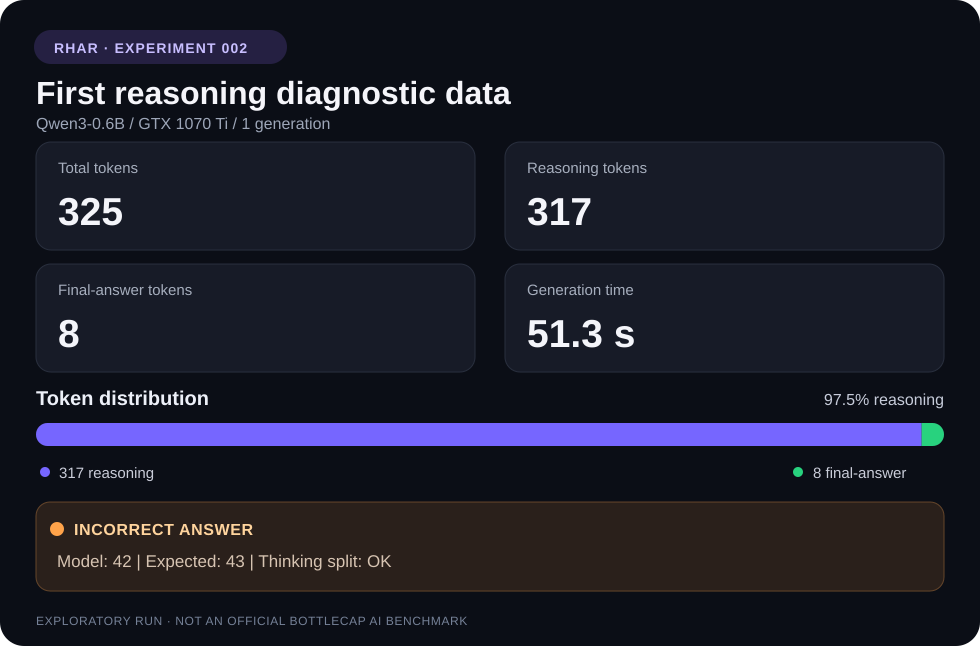

# 🔬 RHAR — Experiment 002: First reasoning diagnostic data

[🇨🇿 Čeština](../../CZ%20docs/experiments/002-reasoning-baseline.md) · [🇬🇧 English](002-reasoning-baseline.en.md) · [Development diary](../DEV-NOTES.en.md)

## 📊 Measured values

| Metric | Measured |
| --- | ---: |
| Total generated tokens | **325** |
| Reasoning tokens (including boundary) | **317** |
| Final-answer tokens (including termination) | **8** |
| Reasoning share | **97.54%** |
| Generation time | **51.3 s** |
| Mean throughput | **6.33 tokens/s** |
| Responses / correct responses | **1 / 0** |
| Successfully separated thinking blocks | **1 / 1** |

**This sample's outcome:** ❌ Incorrect answer. This is neither an estimate of the model's overall task accuracy nor an official benchmark result.

## 🔎 Inspection of the saved record

| Field | Value |
| --- | --- |
| Test | `arithmetic_apples` |
| Expected | `43` |
| Model output | `Final answer: 42` |
| `correct` | `false` |
| `grading_error` | `null` |
| `truncated` | `false` |
| `split_status` | `generated_think_block` |

I inspected fields from the local `records.jsonl`. This confirms that **the format and thinking boundaries parsed successfully**, but the numerical answer was wrong. `grading_error: null` indicates no format error was reported; it is not evidence of correctness.

### ⚠️ Open question: influence of the format example

The diagnostic prompt contained an illustrative `Final answer: 42`, and the model returned `42`. **This match is suspicious but does not prove causation.** A controlled follow-up would be needed to distinguish arithmetic error from possible copying of the example. This test never asked the model to shorten reasoning, and thinking remained enabled.

## 🧪 Provenance and limitations

- **Run date:** 2026-10-09; UTC ID `20261009T210123Z`.
- **Model:** original `Qwen/Qwen3-0.6B`, no RHAR training.
- **Environment:** Kali Linux / WSL2; NVIDIA GTX 1070 Ti.
- **My local artifacts:** `runs/diagnostics/20261009T210123Z/` on my computer.
- **Evidence:** my terminal summary and selected record fields. The complete reasoning trace was not shared.
- **Status:** exploratory diagnosis, **not** official BottleCap AI evaluation, calibrated HRM risk, proven token savings, or implementation of RPS/RPD/TPC.
- **Do not compare to the earlier 371-token run as a model improvement:** conditions differed and no fine-tuned candidate exists.

## 🐇 Proposed next step

Following my decision, remove the potentially misleading example number from the diagnostic prompt (retaining only the final-answer format), test the grading logic, and perform a clearly labeled control run. **Official benchmark prompts remain unchanged.**

## 📐 Visual style for future reports

Document each subsequent run in a matched **CZ/EN pair**: metric panel, reasoning/final token ratio, explicit correctness status, table of grounded values, run identifier, errors, and limitations. Every chart must come from actual evidence. If token splitting is unknown, do not invent a percentage. SVG is the visual layer; the Markdown table remains readable without the image.

**Update 2026-10-09:** I approved removing the potentially misleading example from the diagnostic prompt. The code now uses a neutral formatting instruction without the example number `42`. **This does not change any historical Experiment 002 data.** No post-fix control inference has run yet.
